# Beyond Agentic Harnesses: CalHacks x Hyphenate

This is a slide-by-slide Markdown conversion of the 21-page workshop PDF. Text, tables, code, and diagram relationships are preserved in reading order. Each section includes the original rendered slide for visual reference. Code is transcribed as presentation material, not revised into a tested implementation. Prices and event announcements are the claims in the October 2026 slides, not independently updated information.

- [Original PDF](source/workshop-slides.pdf)
- [Workshop recording on Fathom](https://fathom.video/share/UQKfEaP_BUs_ACNWzcPNP_XhmV843z-Y), October 21, 2026
- [Fathom transcript](transcript.md)
- [Individual slide files](slides/index.md)
- [Supplemental coffee-chain slide supplied by the user](slides/supplemental-coffee-chain.md), added October 24, 2026; separate photograph with deck/session unconfirmed

The 56-minute video, its extracted audio, and its 49,891 exported frames are not in this repository; together they are about 9 GB and exceed GitHub's file limits. The transcript is Fathom's existing automatic transcript.

## Slide 01: Introducing Hyphenate

**The autonomous finance platform.**

The cover shows the Hyphenate team in Times Square beneath a Hyphenate billboard. Two logo rows are labeled **trusted-by** (ending with “& more”) and **backed-by**. The original image preserves those graphic logos.

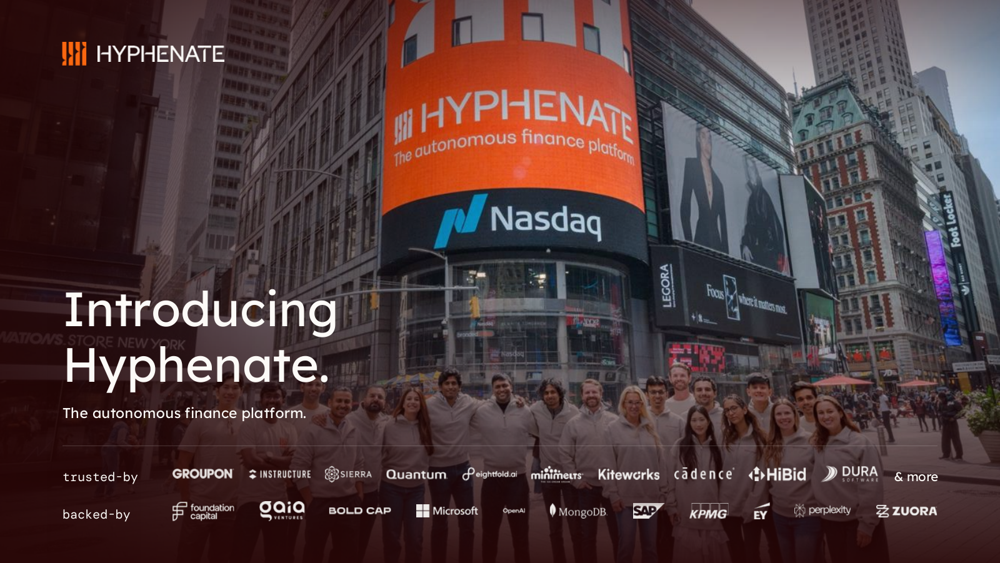

## Slide 02: From a capable agent to a trusted autonomous system

**The next 60 minutes**

| Planned time | Topic |
| --- | --- |
| 0:01 | Hyphenate, and our platform video |
| 0:07 | The track, prizes and judging |
| 0:15 | Systems of record vs. a system of work |
| 0:23 | SaaS vs. outcome-based pricing |
| 0:26 | Building a good system of work |
| 0:45 | Strong vs. weak submissions |
| 0:47 | Your weekend with Hyphenate |
| 0:50 | Q&A |

Questions welcome in Zoom chat any time.

These are the agenda times printed on the slide; they are not measured timestamps from the recording.

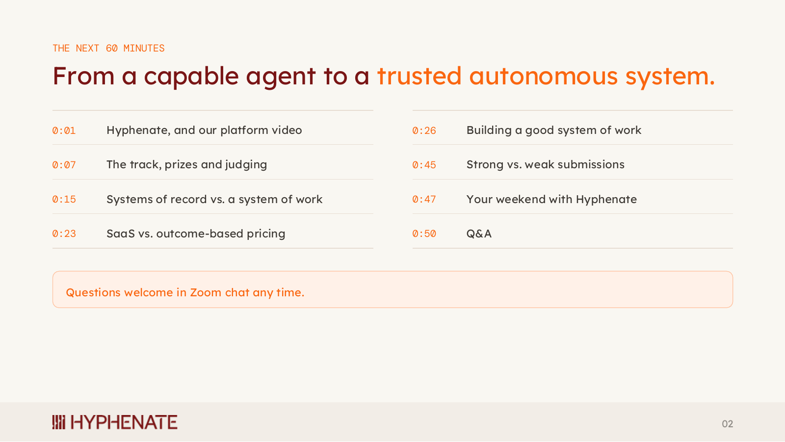

## Slide 03: Introducing Hyphenate: The Autonomous Finance Platform

The visible slide is a linked video poster with the caption **Autonomous Finance**.

[Watch the platform tour on YouTube](http://www.youtube.com/watch?v=1BhxZrKZReQ)

### Video description in the PDF text layer

Autonomous finance, running live. Hyphenate is the autonomous finance platform for the office of the CFO - agents that don't just track the work of finance, they do it, on one unified context of how your company works.

It layers on top of your banks, your ERP, your CRM, along with finance tools like your billing and payroll systems. You don't teach it. You don't write rules. It learns your business from the records you already produce, and gets smarter every day it runs.

Today the knowledge of how your company runs finance lives in your people's heads - how you recognize revenue, why entity four always closes late. When they leave, it walks out with them. Autonomous finance moves that knowledge into the platform, where it compounds instead of resets.

In this tour: revenue from contract to recognized schedule; cash and a forecast that updates continuously; close orchestration and reconciliations that prepare themselves; multi-entity consolidation, board packages, and instant answers.

### About Hyphenate

Hyphenate is the autonomous finance platform for the office of the CFO. Audit-ready agents handle the manual work, bring you in when judgment is needed, and get smarter with every close - running on top of your ERP, with no rip-and-replace and no migration. Revenue, cash, close, AR and AP, board-ready reporting, and instant answers all run on one shared context.

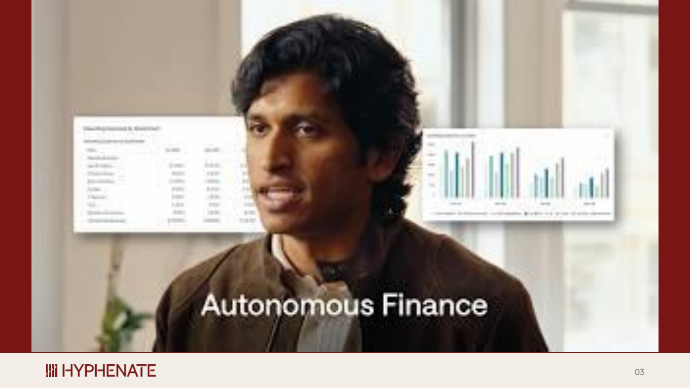

## Slide 04: The Hyphenated Enterprise: autonomous systems for finance

**The Hyphenate track**

Build the system a finance team would bring on board. No finance background needed.

1. **Pick a company.** Any company: a sports team, a coffee chain, a Fortune 500.
2. **Pick a few roles.** Billing, Payroll, Revenue, the Forecast. Your call.
3. **Make it autonomous.** AI that does the work on its own and explains every call.

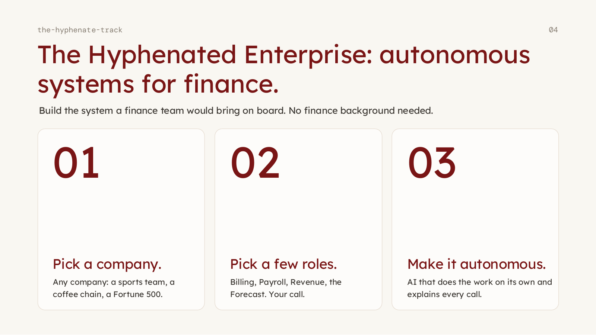

## Slide 05: What you win, and how to win it

| Place | Cash prize per team |
| --- | ---: |
| 1st | $8,000 |
| 2nd | $5,000 |
| 3rd | $3,000 |

**Top 5 teams:** an expedited interview at Hyphenate for every member.

### How we judge

1. Is it real enough?
2. Would you hire it?
3. Did we see something new?
4. Did it have a “wow” moment?

### Office hours

**Friday, 7:00 PM, Theater:** technical workshop and office hours.

[Full brief](https://docs.google.com/document/d/1u4iN8R97ILY3kfHTPKC82zdutHrGx4ze5eCAP-J92w4/edit?usp=sharing), decoded from the slide's QR code.

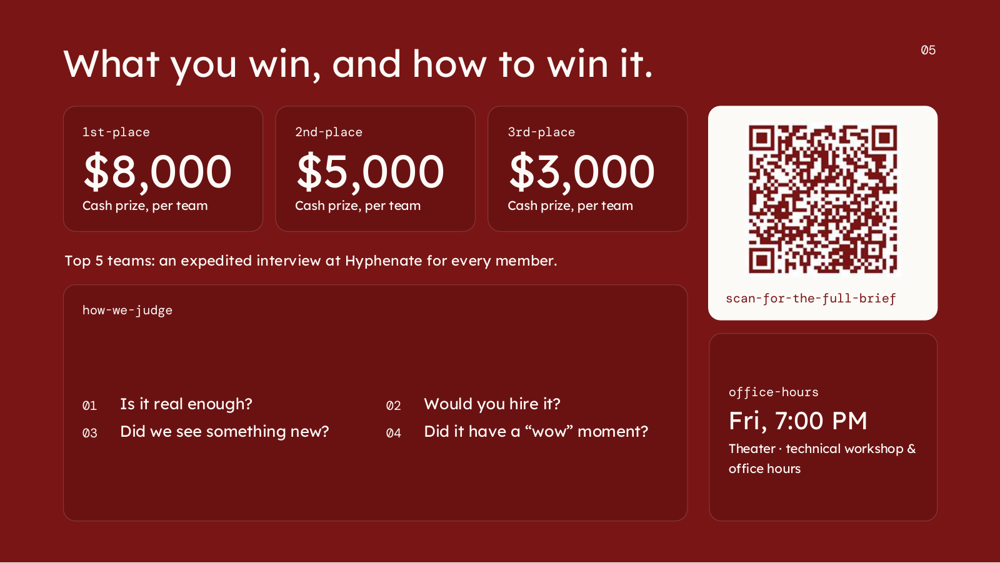

## Slide 06: What a finance team actually does

**The office of the CFO**

| Function | Work |
| --- | --- |
| Revenue | Contracts become revenue schedules |
| Receivables | Payments in, short or late; who to chase |
| Cash | Every bank line matched to what it pays |
| Payables | Bills, stalled approvals, bank changes |
| Accruals | Estimate, confirm, reverse |
| Expenses | Prepaids, assets and leases over time |
| Payroll | Runs and grants into entries |
| Close | Reconciliations, controls, sign-offs |
| FP&A | Budgets, forecasts, variances |
| Reporting | Statements, metrics, board packs |

Ten of many. **Pick a corner of one: one corner done deep beats ten done shallow.**

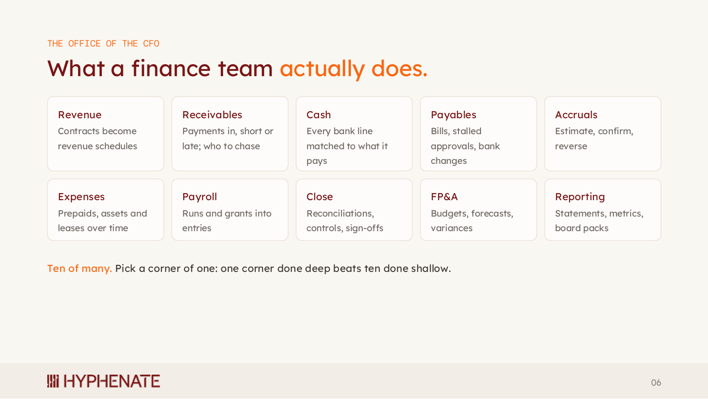

## Slide 07: One refund touches five systems

**The office of the CFO**

One economic event: **a customer gets a refund.**

| System | Consequence |
| --- | --- |
| Billing | A credit note; the invoice reopens |
| Bank | Cash leaves; a payout to match |
| General ledger | Revenue reverses; receivables move |
| CRM | The customer's balance changes |
| Forecast | Next quarter's numbers shift |

Every number has to agree with every other one, and **nothing moves without the right sign-off.**

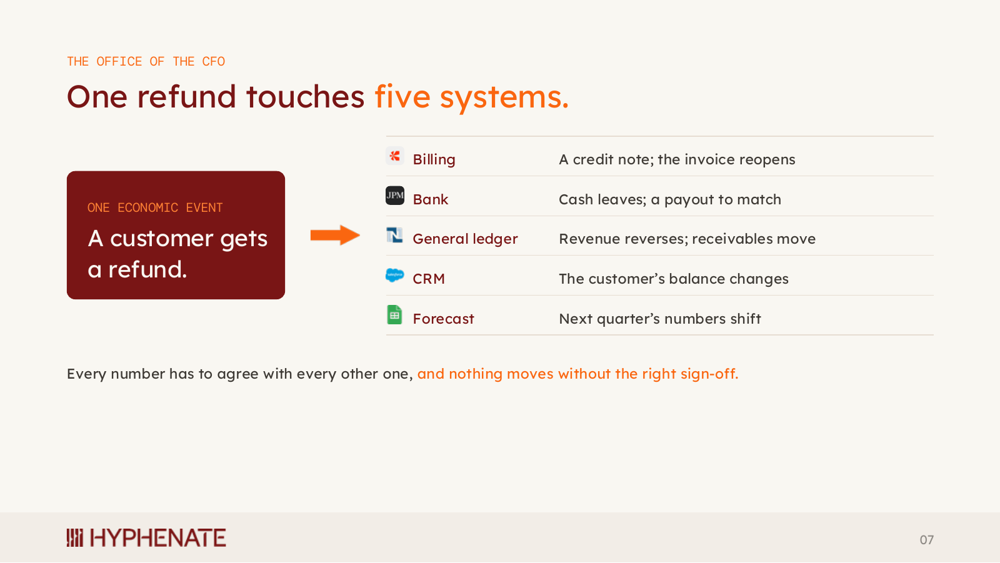

## Slide 08: Harnesses made agents capable

**Beyond agentic harnesses**

**Model + Tools + Loop + Context**

Agent SDKs, MCP, coding agents: an agent that can do the task.

Now put it inside a company. Four questions show up on day one:

| Dimension | Question |
| --- | --- |
| 01: World | Where does it act? |
| 02: Time | What does it remember next quarter? |
| 03: Team | Who does it work with? |
| 04: Limits | What may it do, and can it prove why? |

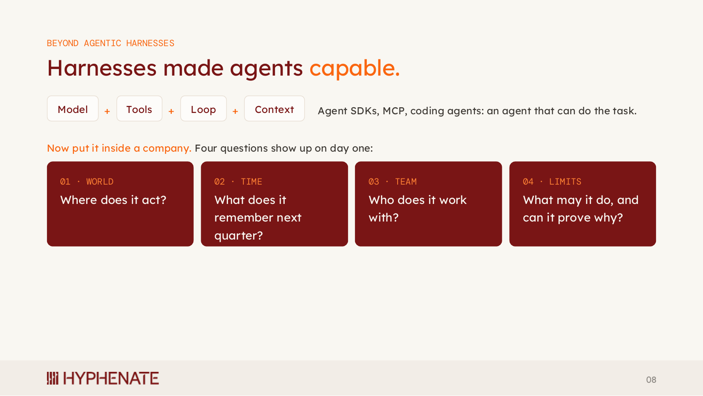

## Slide 09: Records hold the truth. A system of work holds the work

**The one idea**

| | Systems of record | System of work |
| --- | --- | --- |
| Kind | Vertical databases | Execution platform |
| Holds | The truth about the business | The truth about the work |
| Contents | Bank; ERP and ledger; contracts; CRM; inbox | Work items; decisions and reasons; questions and approvals; learned policies; the log |
| Ownership | Finance and IT | You; agents and people share it |
| Your relationship | They disagree with each other. You integrate with them; you don't replace them. | This is what you build. |

Between the two is a **gateway: one door, every write checked.**

```text
Systems of record  <-->  Gateway  <-->  System of work
Business truth          Every write   Work, decisions, approvals,
                        checked       policies, and the log
```

**In code:** GitHub holds the record. The work runs in the execution tools shown on the other side of the diagram; their logos are retained in the slide image.

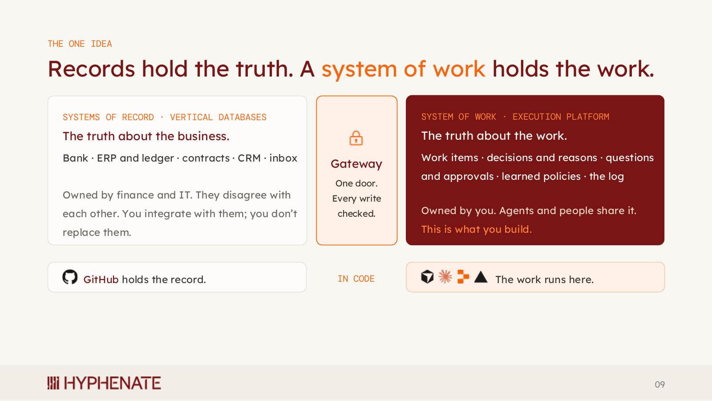

## Slide 10: SaaS pricing sells access. Outcome-based pricing sells work

**Why now: how software gets paid**

| Model | Example | Price or basis shown | Detail |
| --- | --- | --- | --- |
| SaaS: per user | Oracle NetSuite | Approximately $125-199 per full user a month, plus a base fee | Oracle doesn't publish prices; these are industry estimates. |
| Outcome-based: per result | Intercom / Zendesk | $0.99 per conversation Fin resolves; Zendesk $1.50-2.00 per automated resolution | No result, no bill. |
| Hyphenate: on the work | Hyphenate | Not per login | Priced per function or workstream: by the work it takes off the team, not who signs in. |

**Billing per outcome means proving every outcome. That takes a system of work.**

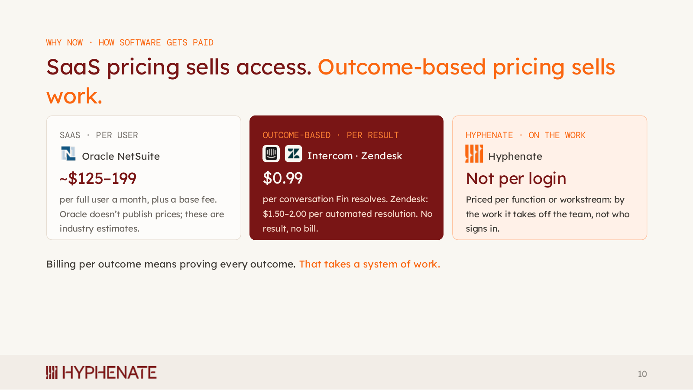

## Slide 11: A good system of work learns, improves and proves

**The blueprint: one wire, end to end**

| Bank wire | Invoice | Difference |
| --- | --- | --- |
| `WIRE IN ACME CORP INV 1042`; J.P. Morgan; $57,975.00 | `INV-1042`; Acme Corp; Oracle NetSuite; $58,000.00 | $25 short |

| Principle | Meaning |
| --- | --- |
| 01: Self-learning | Learns the job at onboarding |
| 02: Self-improving | Gets better with every correction |
| 03: Audit trail | Proves every step, months later |

| Build area | Requirement |
| --- | --- |
| Environment | Sync the records, statefully |
| Agents + humans | Map actors, actions, resources |
| The harness | Tools are CRUD on the work |
| Traceability | Log every transition as a diff |

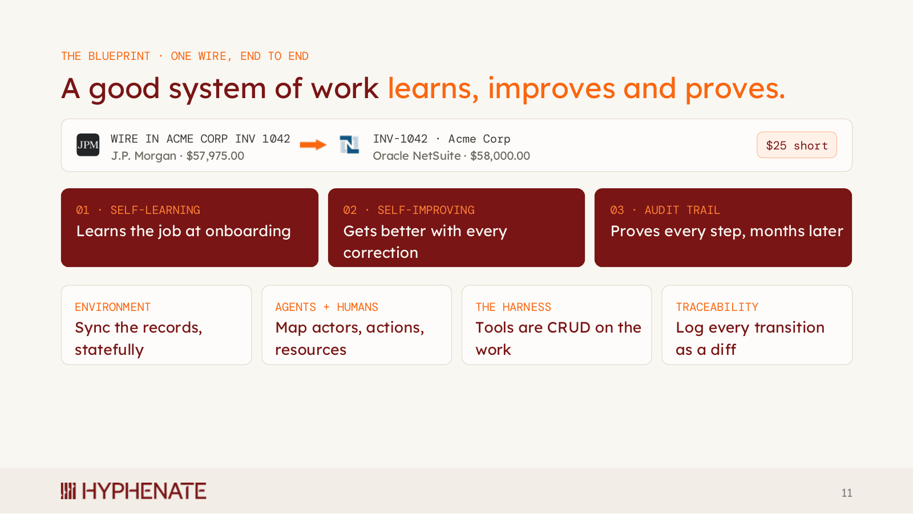

## Slide 12: Learn the job from the company's history

**01: Self-learning, at onboarding**

### Human + system of record

A new accountant shadows for two weeks, reads last year's close binders and asks: what do we do with short wires? The answer lives in her head.

### AI agent + system of work

Queries a year of Oracle NetSuite payments against J.P. Morgan lines, finds how short wires were booked, and drafts a policy.

**`pol-001`: wire ≤ $50 short → 6850 Bank Fees.**

### Agent trace

`ai_agent` / `think`: How did this team book wires that came in short?

`ai_agent` / `run_sql`:

```sql
SELECT account, COUNT(*) AS n, MAX(gap) AS max_gap
FROM   paid_invoices_vs_bank           -- 12 months
WHERE  memo LIKE 'WIRE IN %' AND gap <= 50
GROUP  BY account;
```

Result:

```text
6850 Bank Fees | 214 | 48.00
```

`ai_agent` / `propose_policy`:

```text
pol-001: wire ≤ $50 short → book gap to 6850
evidence: 214 precedents · approver: human_controller
```

Result: `needs_approval`.

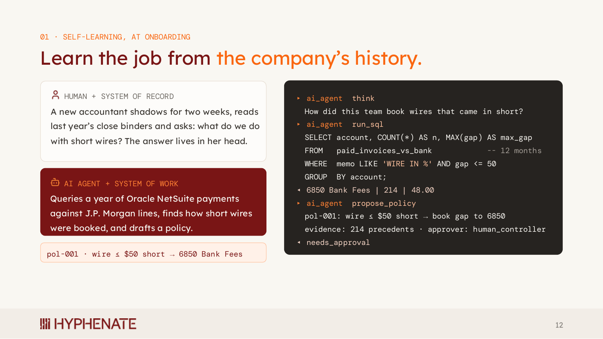

## Slide 13: Every correction becomes precedent

**02: Self-improving, every day**

### Human + system of record

Acme starts paying two invoices with one wire. She splits it by hand and remembers. When she leaves, the lesson leaves with her.

### AI agent + system of work

An accountant corrects its match. The agent finds similar corrections, spots the pattern, and proposes a general policy.

**`pol-014`: one wire, many invoices → split.**

### Agent trace

```text
human_accountant corrected WI-5602
  split one wire across INV-1077 and INV-1078

ai_agent search_precedents(customer="Acme")
  3 alike: several invoice numbers in one memo

ai_agent think
  Memo lists the invoices; amounts add up to
  the wire. Not Acme-specific: make it general.

ai_agent propose_policy
  pol-014: split a wire across every invoice
  number in its memo when the amounts add up
  evidence: prec-311, prec-318, prec-322

needs_approval · human_controller
```

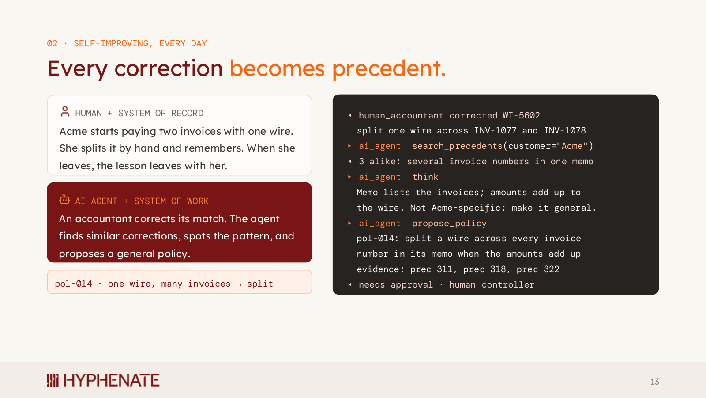

## Slide 14: Months later, “why?” is one query

**03: Audit trail, from day one**

### Human + system of record

February audit: why was INV-1042 closed $25 short? Oracle NetSuite shows a payment and a write-off. The why is in someone's inbox.

### AI agent + system of work

Every step was an event: the bank line, the invoice, the policy and its version, who approved, what changed. The answer is a query.

**Append-only; written with the change.**

```sql
SELECT at, actor, change, why
FROM   audit_log
WHERE  subject = 'INV-1042'
ORDER BY at;
```

| at | actor | change | why |
| --- | --- | --- | --- |
| 09:02 | `sync` | + NEW | `JPM-88310442` |
| 09:03 | `ai_agent` | → PROPOSED | `pol-001 v1`, $25 gap |
| 11:40 | `human_accountant` | → APPROVED | “intermediary fee” |
| 11:41 | `gateway` | → POSTED | NetSuite `PYMT-7781` |
| 11:41 | `gateway` | + JE | $25.00 → 6850 |

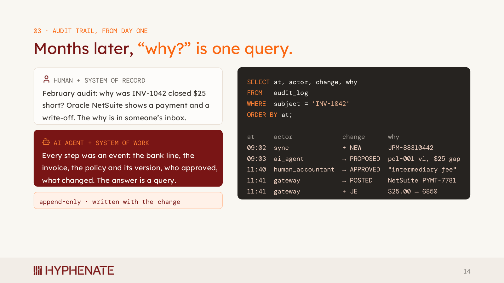

## Slide 15: Sync the systems of record into one shape

**Build 1: the environment**

```text
Sources  -->  Raw           -->  Standardised  -->  Golden
              Landed as-is      Typed, signed      Kept current
```

**One shape:** bank transaction; invoice and payment; customer; GL account; entity; vendor.

### Stateful, not a one-off export

Change-only sync with a cursor per source. Stable ids, so a re-sync never duplicates. Late bank posts re-read. Every golden row traces to its raw row.

### Schema shown on the slide

```sql
CREATE TABLE bank_transaction (
  id         TEXT PRIMARY KEY, -- md5(acct|src_id)
  source     TEXT,             -- 'jpm'
  txn_date   DATE,
  amount     NUMERIC(18,2),     -- 57975.00, in > 0
  memo       TEXT,             -- 'WIRE IN ACME…'
  raw_ref    TEXT              -- source row
);
CREATE TABLE invoice (
  id         TEXT PRIMARY KEY, -- 'INV-1042'
  customer   TEXT,             -- 'Acme Corp'
  amount     NUMERIC(18,2),     -- 58000.00
  status     TEXT,             -- 'Open'
  raw_ref    TEXT              -- source row
);
CREATE TABLE sync_cursor (source, cursor, at);
```

The `sync_cursor` declaration is abbreviated in the source slide; no missing column types have been invented here.

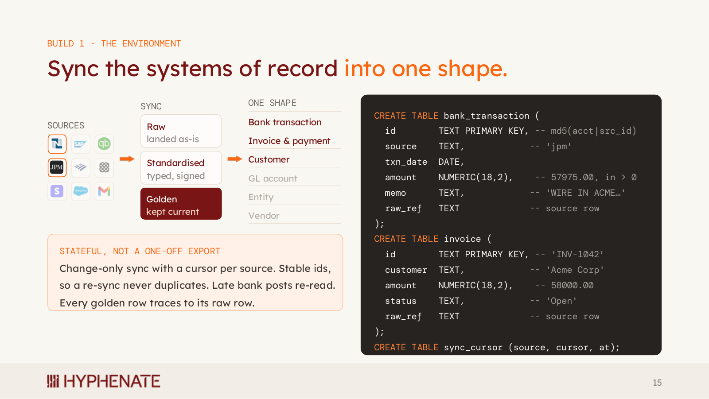

## Slide 16: Map who may do what, to which record

**Build 2: agents and humans as one team**

The slide lists three independent dimensions:

- **Actors:** sync job; AI agent; accountant; controller; gateway.
- **Actions:** create; propose; ask / answer; approve; post.
- **Resources:** bank line; invoice; work item; policy; journal.

### Our wire: checked on every call

| Actor | Action | Target | Allowed? |
| --- | --- | --- | --- |
| `sync` | create | `WI-5531` | Yes |
| `ai_agent` | propose | `WI-5531` | Yes |
| `ai_agent` | approve | `WI-5531` | No |
| `human_accountant` | approve | `WI-5531` | Yes |
| `ai_agent` | post | NetSuite | No |

```python
ROLES = {  # role -> resource -> allowed actions
    "sync":             {"work_item": {"create"}},
    "ai_agent":         {"work_item": {"propose", "ask"},
                         "policy":    {"propose"}},
    "human_accountant": {"work_item": {"approve", "answer"}},
    "human_controller": {"policy":    {"approve"}},
}  # no role can "post": only the gateway does

def can(actor, action, res) -> bool:
    if action not in ROLES[actor.role].get(res.kind, ()):
        return False
    if action == "approve" and res.proposed_by == actor.id:
        return False  # separation of duties
    return True
```

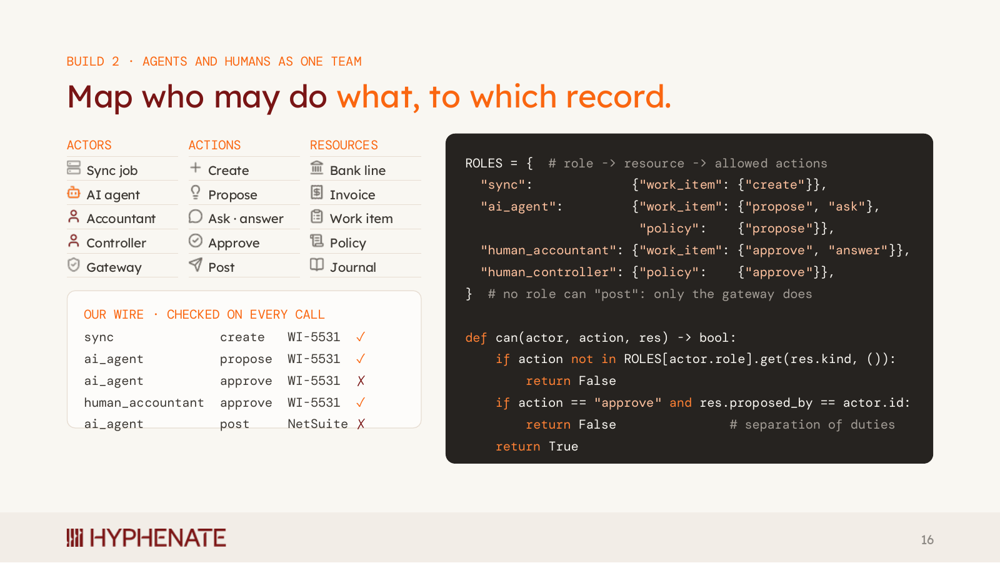

## Slide 17: The agent's tools are CRUD on the work

**Build 3: the harness meets the application**

### Work-item lifecycle

```text
NEW                          sync: a new bank line
  |
  | propose · ai_agent
  v
PROPOSED -- ask --> NEEDS_INFO
    ^                 |
    +---- answer -----+
  |
  | approve · human_accountant
  v
APPROVED
  |
  | post · gateway -> NetSuite
  v
POSTED                       the only write to the record
```

| CRUD operation | Meaning here |
| --- | --- |
| C | Sync creates a work item per bank line |
| R | Tools read records, policies, precedents |
| U | Every change goes through `transition()` |
| D | Never: a reversal is a new transition |

```python
TRANSITIONS = {  # (state, action) -> next state
    ("NEW",        "propose"): "PROPOSED",
    ("PROPOSED",   "ask"):     "NEEDS_INFO",
    ("NEEDS_INFO", "answer"):  "PROPOSED",
    ("PROPOSED",   "approve"): "APPROVED",
    ("APPROVED",   "post"):    "POSTED",  # NetSuite
}

@tool  # the harness sees tools, not tables or keys
def propose_match(item_id, invoice_id, policy_id):
    item = work_items.read(item_id)  # R
    return transition(item, "propose", AI_AGENT,  # U
                      patch={"invoice": invoice_id,
                             "policy": policy_id},
                      reason=f"{policy_id}: gap within tolerance")
```

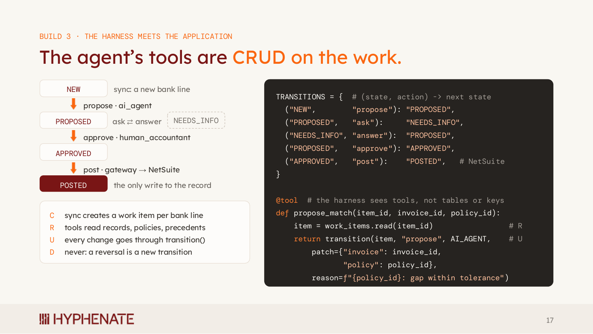

## Slide 18: Log every transition as a diff

**Build 4: permissions and traceability**

### Example event

**11:40 · `human_accountant` · approve**

| Field | Value |
| --- | --- |
| Subject | `WI-5531` · `INV-1042` |
| Diff | `state: PROPOSED → APPROVED`; `approved_by: ∅ → human_accountant` |
| Reason | “intermediary fee” |
| Evidence | `JPM-88310442`; `INV-1042`; `pol-001 v1` |

- **Append-only:** fixes are new events.
- **Same commit** as the change itself.
- **Denied attempts** are logged too.

```python
def transition(item, action, actor, patch=None, reason=""):
    to = TRANSITIONS.get((item.state, action))
    ok = to is not None and can(actor, action, item)
    before = snapshot(item)

    if ok:
        item.update(patch or {}, state=to)
    with db.transaction():  # one commit
        if ok: db.save(item)
        db.append("audit_log", dict(  # append-only
            at=now(), actor=actor.id, action=action,
            subject=item.id, allowed=ok, reason=reason,
            diff=diff(before, snapshot(item)),
            evidence=item.evidence))  # source row ids
    if not ok: raise Denied(action, item.id)
    return item
```

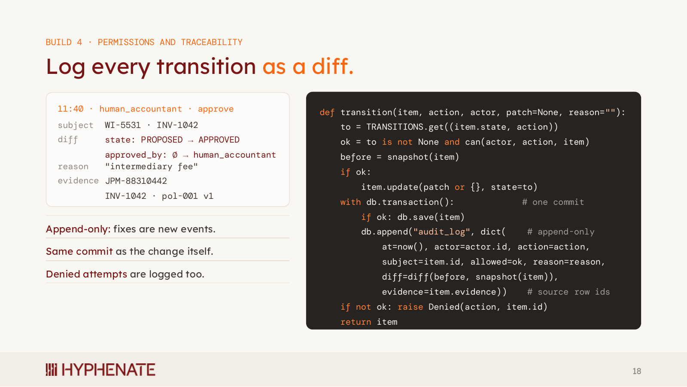

## Slide 19: Strong vs. weak submissions

**What we look for**

### Strong

- A real company with a messy corner, and an answer key.
- A few roles done deep, named in one line.
- Asks at the right moment, and handles a no.
- Limits enforced in code; a record of every call.
- A moment on stage, and a score to back it.

### Weak

- A chatbot over a spreadsheet, or a one-shot extractor.
- Ten workflows, none of them deep.
- Clean happy-path data that only works on the script.
- An admin key, and “the prompt tells it not to.”
- Memory that ends with the context window; “trust me.”

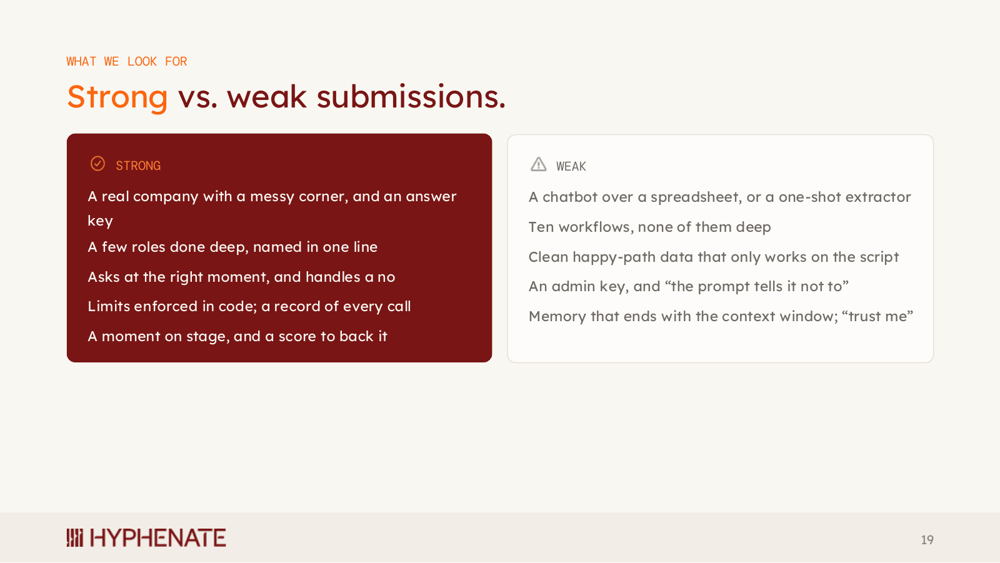

## Slide 20: Your weekend with Hyphenate

**Pavan: announcements**

| When | Event | Location or instructions |
| --- | --- | --- |
| Friday, 7:00 PM | Technical workshop and office hours with our founding engineers | Theater |
| Saturday, 12-2 PM | Invite-only lunch for 2027 grads | Drop your resume at the booth |
| Saturday, 2-4 PM | Boba and cookies mixer, open to all | Mixer Area, Gate 6 |
| All weekend | Our booth: questions, jobs, hoodies | While they last |

### We're hiring

| Role | Details |
| --- | --- |
| Software Engineer, New Grad | Full-time; starts 2027; New York |
| Software Engineering Intern | Full-time; Summer 2027 or earlier; New York |

The two application QR codes are preserved in the original slide. Decoded destinations:

- [Software Engineer, New Grad](https://jobs.ashbyhq.com/hyphenate/67d0c7d0-fddb-4b8d-aed8-0647337a988e?utm_source=calhacks)
- [Software Engineering Intern](https://jobs.ashbyhq.com/hyphenate/3ff6e57d-5430-4836-b6f0-19044d8ee6d8?utm_source=calhacks)

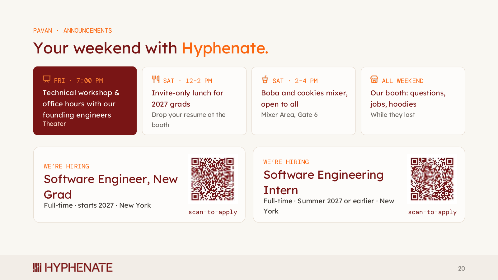

## Slide 21: Questions?

**Build the system a finance team would bring on board.**

| Contact point | Details |
| --- | --- |
| In-person workshop | Friday, October 23; 7 PM; Theater |
| Booth | All weekend; jobs, hoodies, help |
| Slack | `#cohost-hyphenate` |

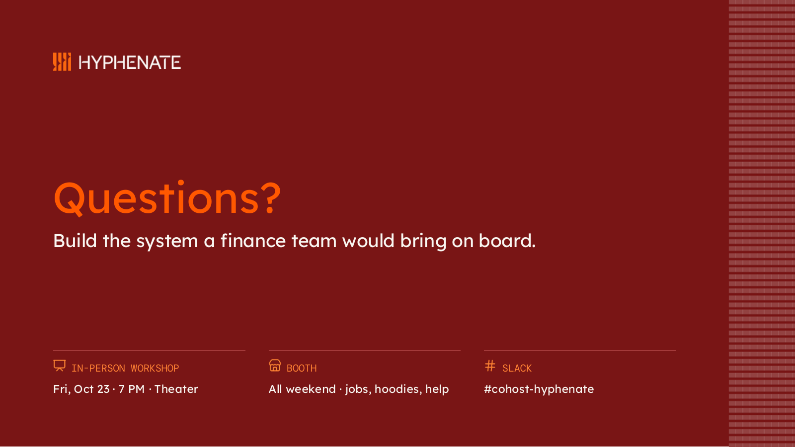

## Supplemental slide: A coffee chain

Source: [original photograph supplied by the user](slides/images/coffee-chain-slide-photo.png), added October 24, 2026. The photographed slide is labeled **06** and **example-01 · the-business**. It differs from slide 06 in the preserved workshop PDF; its exact deck/session is unconfirmed. The text below is transcribed from the photograph, not from the recording.


### A coffee chain

**The job: split each store’s tips every Sunday.**

**18 stores · 240 baristas**

#### Learns

`self-learning`

Reads six months of tips and payroll runs to learn the split.

**learned**

- Split by hours worked
- Shift leads get 1.2×

#### Runs

`ai-automated`

Every Sunday night, splits each store’s tips and drafts payroll.

- 240 shares across 18 stores
- Payroll draft ready Monday

#### Escalates

`needs-review`

A new store logged $310 in cash tips with no shifts attached.

**SM · Routed to the store manager**

`confidence 41% · no precedent`

- Holds that store’s payout

#### Improves

`new-policy`

Manager: “Split cash tips by scheduled hours.”

- Saved as policy for all 18
- Never asked again

**Next Sunday: no human needed**

### Reading this example alongside the workshop

This is an interpretation of the photographed example, not additional speaker transcript: the demo spans recurring work. It shows learning from historical records, performing the job, holding an uncertain payout, routing a specific question to the responsible human, retaining the answer as policy, and applying that lesson on the next occurrence. To demonstrate the improvement, show the next Sunday’s case being handled under the saved policy.

The photograph does not specify the policy’s approval process or applicability conditions. The preserved workshop’s slides 12–13 show proposed policies awaiting controller approval, and slides 16–18 show permission checks and audit records. Read the example together with those controls. “Never asked again” is the slide’s wording; the demonstrated improvement should concern subsequent cases covered by the approved policy.

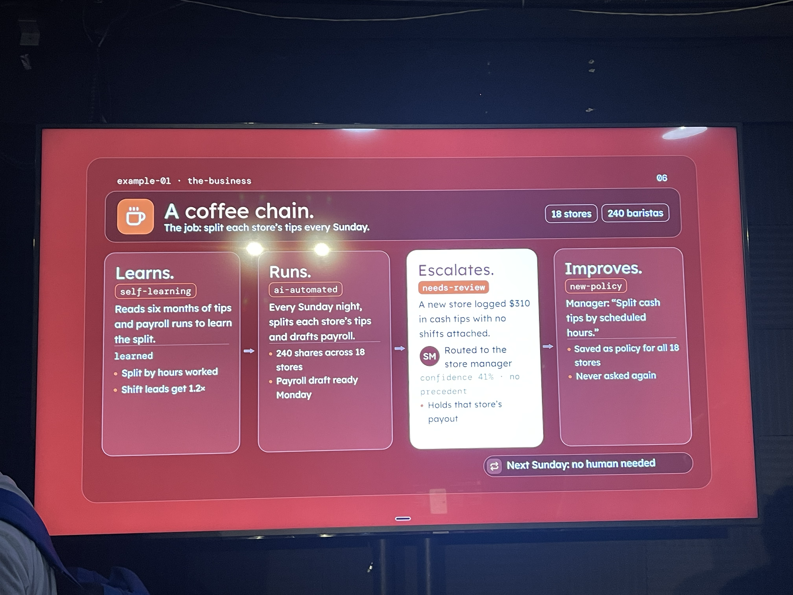
