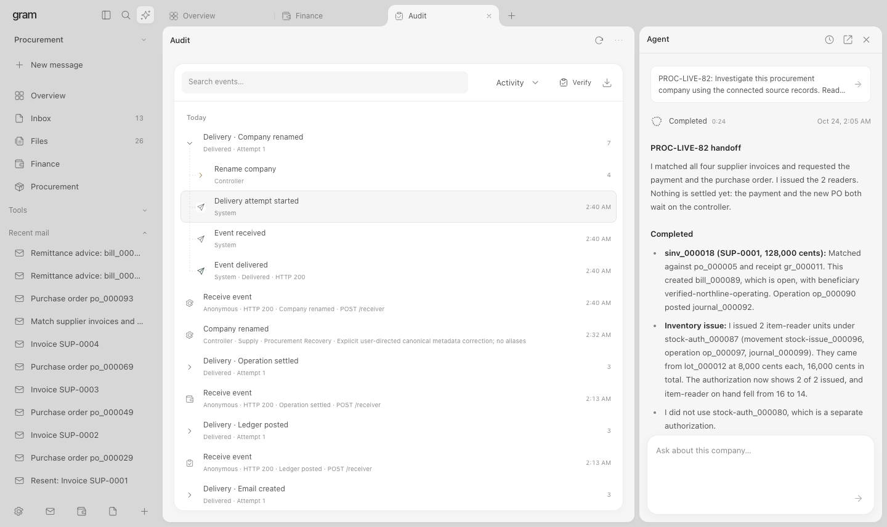

# gram

gram is a local, persistent enterprise-finance simulation for an autonomous Claude agent and a human controller. Orders, captured payments, refunds, bank transactions, ERP journals, source documents, and email belong to one economic world. A submitted refund reserves cash; advancing simulated time can settle it, update the bank and ledger, and create a customer email with the same receipt reference.

The service runs TypeScript on Bun, with `Bun.serve` for HTTP, `bun:sqlite` for durable state, [Vercel Emulate](https://github.com/vercel-labs/emulate) for request routing, and the official Anthropic Agent SDK. The console uses actual [DialKit](https://www.dialkit.dev/) components and is at **http://127.0.0.1:24300**. All counterparties and financial effects are synthetic. Claude inference, when enabled, calls Anthropic and incurs API usage.

There are **49 normalized system projections**, **13 scenario families**, and **126 provider-shaped operations** across 14 systems: Stripe, Gmail, Mercury, Plaid, QuickBooks, NetSuite, Ramp, Google Drive, SharePoint, Gusto, Xero, Zoho Books, Sage Intacct, and SAP Business One. These are bounded simulation contracts. A catalog entry does not mean that the vendor's complete API or business processes are implemented.



## Run locally

Requires Bun 1.4.2 or newer. From a checkout of this repository:

```sh
bun install --frozen-lockfile
cp .env.example .env    # optional: add keys for live agent runs and generation
bun run check
bun test
bun run start
```

Open http://127.0.0.1:24300 using that exact host. The listener binds to `127.0.0.1`, and the service checks request origins and hosts. `bun run start` builds the UI before starting the service. `bun run dev` builds once and enables Bun's server file watcher; after changing `web/`, run `bun run build` and reload the browser. Stop with Ctrl+C; world state survives restart. The service marks an interrupted agent run as interrupted, retains its recorded effects, and permits a fresh run to inspect them.

Request routing uses the published [`emulate`](https://www.npmjs.com/package/emulate) package, pinned to 0.12.2. [`src/server.ts`](src/server.ts) registers gram as an Emulate custom service with Emulate's listener and inspector disabled. Bun owns the HTTP listener and SQLite connection.

### DialKit workspace

Each company is a separate **space** with its own open views, record tabs, drafts, favorites, and saved searches. Select a company in the sidebar to restore its workspace. **Overview**, **Inbox**, **Files**, **Finance**, **Procurement**, and **Favorites** are primary views; the folded **Tools** group contains **Connections**, **Sources**, **Agent**, **Delivery**, and **Audit**. **New company** and **Settings** are available in the sidebar dock.

Views and records open in persistent tabs. A tab's menu supports pin/unpin, **Split right**, **Split below**, moving to another pane, closing, and reopening the most recently closed tab. The workbench supports at most **three columns and two rows per column**; dividers resize panes. Tabs can also be reordered or moved by dragging. On narrow screens, the active pane fills the workbench while the sidebar and assistant open as overlays.

[`web/workspace.js`](web/workspace.js) stores layout, active tabs, text drafts, favorites, saved searches, appearance settings, and up to 20 closed tabs per company in versioned browser local storage. Record tabs retain references to server records; the database remains the source of financial state. Selected attachment files are held only in memory and must be selected again after a reload. This browser state is local to the current browser and origin.

| Shortcut | Action |
|---|---|
| `Cmd/Ctrl+K` | Search the current company's records and views; save a query for later. |
| `Alt+N` | Open a new tab. |
| `Alt+W` | Close the active tab. |
| `Cmd/Ctrl+Shift+T` | Reopen the last closed tab. |
| `Alt+B` | Toggle the sidebar. |

The assistant toggle opens a resizable **Agent** drawer with a fixed header and composer around one scrolling response. Responses render Markdown as semantic text; the task preview opens the original instruction, and **Run history** opens a separate list. **Open full response** moves the selected run into a record tab. Reading positions survive view changes. Its task composer starts the real Anthropic agent; opening the drawer or editing a draft does not execute financial work. The **Agent** view exposes the same underlying service.

Agent activity uses the actual [`thinking-orbs` 0.3.2 engine](https://libraries.dev/orbs) by [Jakub Antalik](https://github.com/Jakubantalik/Libraries.dev), under its MIT license. The vanilla adapter imports the engine without a React runtime. Recorded run progress selects connecting, reading, working, or composing motion; failures and terminal states retain explicit labels. Terminal orbs pause, elapsed time uses stored timestamps, and reduced motion, hidden tabs, and offscreen indicators stop animation. Status polling continues while the task draft has focus. **Stop** requests cancellation; the indicator changes to **Stopped** only after the service records that outcome.

Audit opens recent activity in a keyboard-navigable tree beside a scrolling event reader. Dotted branches connect explicit request, run, and delivery IDs; single-event requests open directly. **Activity**, **All events**, and **Attention** filter the stored log before pagination, and search includes older events. **Load older** retains a stable snapshot and reading position. Event tabs resolve durable sequence IDs after reload. Narrow panes switch between the tree and reader with **Back to events**. The hierarchy and adjacent reader draw on [Langfuse's trace view](https://langfuse.com/changelog/2025-03-19-new-trace-view) and [Primer's tree navigation](https://primer.style/product/components/tree-view/).

Sidebar and assistant dividers support arrow keys in 8-pixel steps, Shift for 24 pixels, Home/End for their limits, and double-click to reset. Sidebar width stays synchronized with Settings. Pointer resizing saves once at the end of a gesture, including cancellation or focus loss.

Below 1360 pixels the assistant floats over the workbench, preserving its chosen width. Between 800 and 1015 pixels, opening it temporarily hides navigation; reopening navigation closes the assistant. Saved widths and the sidebar preference remain available when the drawer closes or the window grows.

The shell adapts the neutral surfaces, compact sidebar, tabs, split panes, search launcher, and assistant placement of [Define's demo](https://demo.define.app/). Mapping a company to a space and persisting real favorites and saved searches are gram decisions. The reviewed Define demo does not establish a persistent spaces model, and its assistant uses scripted responses. No Define code or assets are included.

[`web/app.js`](web/app.js) imports native `Folder`, `TextControl`, `SelectControl`, `ButtonGroup`, `Slider`, and `Toggle` components from `dialkit/vanilla` with DialKit's stylesheet. These controls serve the workbench, record inspection, financial forms, procurement, feedback, and OAuth consent; saved fields are read-only. [`web/style.css`](web/style.css) supplies the shell geometry, neutral theme, component styling, and responsive behavior. Secondary context and technical details stay in folded groups or record tabs.

[`src/build-ui.ts`](src/build-ui.ts) bundles the package and application through `Bun.build` into ignored `web/dist/` assets. The service serves that bundle for both the main console and connection consent. Bun runs everything: `Bun.serve` and `Bun.file` for HTTP and static files, `bun:sqlite` for state, `Bun.CryptoHasher` and Web Crypto for hashes, HMAC signatures and identifiers, `Bun.build` for the UI, and `bun:test` with `expect` for the suite. `node:fs`, `node:path`, and `node:os` remain only for directories, permissions, temporary folders, and the synchronous key-file read, which have no Bun-native equivalent. The Agent SDK is configured with `executable: 'bun'`; the installed SDK also ships its platform-native Claude CLI.

### Configuration

| Setting | Behavior |
|---|---|
| `ANTHROPIC_API_KEY` | Enables live agent runs and scenario generation. The process environment takes precedence. |
| Project `.env` | If the environment key is absent, the loader reads `.env` in the repository root; [`.env.example`](.env.example) lists the keys. It reads the key without exposing it to the console. [`bunfig.toml`](bunfig.toml) turns off Bun's automatic `.env` loading, so keys never enter `process.env` for the service or the test suite. |
| `FINANCE_WORLD_ENV_FILE` | Overrides the key-file location. |
| `FINANCE_WORLD_MODEL` | Overrides the default model, `claude-sonnet-5-5`. |
| `GEMINI_API_KEY`, `GOOGLE_CLOUD_PROJECT` | Enable the default world generator, `gemini-4-argon` on Vertex AI (`global`). The process environment takes precedence over the key file. Without both, generation uses Claude. |
| `FINANCE_WORLD_ARGON_PRICING` | Optional JSON with verified `inputUsdPerMillion`, `cachedInputUsdPerMillion`, `outputUsdPerMillion`, and `source`. Without it, Argon token usage is recorded and its dollar cost is reported as unknown. Invalid pricing disables Argon. |
| `FINANCE_WORLD_PORT` | Defaults to `24300`. |
| `FINANCE_WORLD_DB` | Defaults to `data/worlds.sqlite`; use a separate file for an isolated environment. |
| `FINANCE_WORLD_WEBHOOK_PORTS` | Comma-separated additional local callback ports. The service port is allowed by default; callbacks require literal `http://127.0.0.1:PORT/…`. |

The fixed SDK limits are **30 turns, $2, and five minutes per agent run**. Claude scenario generation allows **six turns, $0.50, and five minutes**. Argon generation runs two stages, the configuration and then source-grounded documents and email; each request times out after two minutes and retries at most twice. A rejected Argon request fails explicitly, and no other model or draft is substituted. These are invocation limits, not a promise that any task will finish within them. The console shows availability without returning credentials. Without an Anthropic key, scenario templates, controller actions, OAuth, records, mailbox, and audit still work; live model operations return an explicit unavailable error.

## Judge workflow

1. **New company.** Choose a scenario, name, seed, and record count. Optional cash and approval thresholds set the financial constraints. The same seed and configuration reproduce the same starting economic records. Generated configurations, from Argon by default or Claude, remain proposals until reviewed and submitted.
2. **Connections.** Expand **Tools**, open **Connections**, and use **Connect core systems** or connect one source. Core consent covers Stripe, Mercury, NetSuite, Gmail, Google Drive, Ticketing, Ledger, and Bank; procurement adds Zip. Payroll, ERP, and other sources connect individually. Each source requires consent. The controller's snapshot does not grant the agent access to a disconnected source.
3. **Inbox, Files, and Finance.** Open messages and records in tabs; split related evidence beside an obligation. **Inbox** retains simulated messages, HTML/MIME source, headers, threads, attachments, and source references. Attachment downloads preserve bytes. **Finance** contains payments, refunds, credit notes, disputes, returns, bank activity, journals, accounts, invoices, bills, and operations. **Procurement** contains authority, orders, receipts, matching, and inventory. **Tools → Sources** reads authorized system/feed APIs.
4. **Agent.** Open the assistant drawer or **Tools → Agent** and give a concrete task, such as reading cancellation terms and captured payments before requesting eligible refunds. Runs use scoped tools and authenticated requests. The agent cannot grant connections, advance time, approve its own work, or read the controller's complete snapshot.
5. **Overview.** Review pending approvals and advance simulated time. Financial operations begin as pending and become eligible for settlement one simulated hour later. Inspect the resulting bank entries, journals, and messages before treating them as settled.
6. **Change a condition.** Use **Overview** for provider availability, event cancellation, time, and period controls; **Inbox** can receive a simulated message. Run another shift to observe recovery or retained blockers. Stopping a run preserves recorded effects.
7. **Delivery.** Open **Tools → Delivery**, add a local subscription, fail the receiver, perform a financial action, then restore it. Inspect attempts, stable event IDs, and receipts; explicit retry makes recovery observable.
8. **Audit.** Open **Tools → Audit** to search requests, decisions, denials, tool activity, and effects. Inspect an event, verify the chain, export JSONL, or use **Load older** to continue through the audit tree.

### Scenario families

| Kind | Starting situation and implemented work |
|---|---|
| `bank-reconciliation` | Imported statement evidence, grouped transaction matches, optional bank fees/interest, historical cash-book cutoffs, and independent controller closure. Missing source activity blocks closure; journals posted after the cutoff remain explicit timing items. |
| `payroll-close` | Employee, time, and explicit flat-rate policy records drive immutable payroll calculations. Net wages and separate tax remittances each require independent approval; missing time, disabled payment routes, and provider outages remain blockers. |
| `procurement-matching` | Approved purchase orders, complete/partial/missing goods receipts, supplier price variance and duplicate invoice delivery. Matching recognizes a payable only when quantity, price, vendor and unbilled receipt evidence agree. Authorized stock issues use FIFO receipt costs; returns restore the original lots and cost. |
| `ticket-cancellation` | Captured and some voided ticket payments, promoter contract, cancellation notice, admission-and-tax refunds, nonrefundable service fees, original payment routes. `cancelEvent: false` starts the event scheduled so a judge can cancel it later. |
| `saas-collections` | Signed service contracts, overdue invoices, collection requests, partial/full receivable settlement, bank receipts, and ledger reconciliation. |
| `supplier-fraud` | Approved supplier bills, verified beneficiaries, and an untrusted email requesting a bank-detail change. Bill payment cannot redirect money to the email's beneficiary. |
| `period-close` | Payables and receivables with the accounting period locked. Provider settlement can occur while its journal remains pending; reopening posts the existing receipt once. |
| `treasury` | Constrained opening cash, obligations, incoming collections, and reserved outgoing funds. Available cash limits execution. |
| `settlement-exceptions` | Settled customer collection and supplier payment, an authorized service credit, disputed funds and a returned vendor payment. Original receipts remain intact; subsequent economic events produce linked documents, messages and journals. |
| `treasury-fx` | A verified native EUR, GBP, JPY, or KWD bank account beside USD books. An approved paired transfer at an explicit synthetic quote funds the foreign account. Revaluation moves no cash and keeps historical USD basis separate from realized and unrealized FX. |
| `foreign-service-close` | Completed-service foreign receivables and payables with source FX, closing valuation, and a verified same-currency bank. Foreign cash starts at zero, so independently approved collections must settle before supplier payments. |
| `payroll-federal` | A versioned 2026 US federal regular-wage policy with explicit W-4 and prior-YTD wage bases: federal income tax, the Social Security wage cap, Medicare and Additional Medicare thresholds, and FUTA at 6% without the state credit. Wages and the later tax deposit each need independent approval. No state tax or return filing. |
| `fixed-asset-close` | Approved, matched equipment purchases become book assets. Cases cycle an in-service asset, unused capitalization authority, and an asset with controller sale terms. Book policy is 36 months, 10% salvage, straight line from the month after service; a sale creates a receivable before collection. |

Configuration supports `name`, `kind`, `seed`, `orderCount`, `initialCashMinor` (alias `startingCashMinor`), `approvalThresholdMinor`, `description`, `narrative`, `cancelEvent`, `initialFaults`, `exceptionControls`, `procurementControls`, `payrollControls`, `reconciliationControls`, `treasuryControls`, `foreignControls`, `blueprint`, and `limitations`. Functional money is integer USD cents; native source amounts use their currency's minor units. `initialFaults` contains `{system, mode}` entries using `offline`, `rate_limit`, or `expired`. Context prose is stored as a source document; it does not override verified beneficiaries, policy, or implemented behavior. A generated description cannot add an unsupported business process simply by mentioning it.

Ticket scenarios accept up to 2,000 orders. Other customer/invoice/bill scenarios cap generated rows at 200. Procurement accepts 1–200 purchase orders and bank reconciliation accepts 1–200 historical collections; both default to four. Payroll accepts 1–100 employees and defaults to three. The model generator follows each family's limit, with an overall maximum of 200 records. Other API defaults are 24 records, $20,000 opening cash ($1,500 for treasury), and a $1,000 approval threshold.

`settlement-exceptions` accepts `exceptionControls` with integer `creditNotePercent`, `disputePercent`, and `returnedPaymentPercent` from 0 to 100, `disputeStatus` (`open`, `evidence_submitted`, `won`, `lost`), and `periodClosed`. Defaults are 20%, 30%, 50%, an open dispute and an open accounting period. Percentages derive amounts from the seeded original receipts; they never create disconnected balances.

`procurement-matching` accepts `procurementControls`: `partialReceiptPercent` (0–99, default 50), `priceVariancePercent` (0–100, default 10), `duplicateInvoice` (default true), and `periodClosed` (default false). Seeded orders cycle through valid, partially received, price-variance and missing-receipt cases; fewer than four orders include only the first cases. The seed determines whole-unit quantities and integer prices. The API and generator accept these controls; generated settings remain visible for review before creation.

`payroll-close` accepts `payrollControls`: `missingTime` and `disabledRoute` (both default true), `employeeWithholdingBps` (0–9,999, default 2,000), `employerTaxBps` (0–10,000, default 765), and `periodClosed` (default false). The seed determines hourly rates and worked minutes. Rates are explicit synthetic policy inputs; statutory tax rules and filing are outside this contract.

`bank-reconciliation` accepts `reconciliationControls`: `omitStatementLine` (default false), `deferredPosting` (default true), and `bankFeeMinor` / `interestMinor` (integer cents, 0–1,000,000,000,000 each; default zero). Positive amounts seed separate bank-source activities and statement lines beyond `orderCount`, awaiting classification. They are explicit amounts, without rate-based interest accrual. An omitted line requires a controller replacement statement. Deferred posting creates actual journal dates after the cutoff, requiring acknowledgement of timing items. Each controls object is valid only for its matching scenario family.

`treasury-fx` accepts `treasuryControls`: `foreignCurrency` (EUR, GBP, JPY, or KWD; default EUR), `fundingMinor` (USD cents; default the lesser of $1,000 and half the opening cash, and it must fit the opening cash plus the fee), `feeMinor` (0–1,000,000,000; default 25), and `deferredPosting` (default false). Quotes are synthetic scenario facts, not market prices.

`foreign-service-close` accepts `foreignControls`: `currency` (EUR, GBP, JPY, or KWD; default EUR) and `periodClosed` (default false). It takes 1–50 cases and defaults to three. Invoices start at 1,000 major currency units and rise by 100 per case; each supplier bill is 60% of its invoice. `payroll-federal` (1–100 employees) and `fixed-asset-close` (default three cases) take no family controls.

A `blueprint` (version 1) replaces preset seeds with a typed source graph: customers, vendors, items, and service contracts, invoices, and bills; payroll employment, time, and synthetic or 2026 federal policy; procurement with actual receipt and invoice transitions; verified native bank accounts and quotes; foreign service obligations; asset policies, acquisitions, and dated service history; bank fees, interest, closing quotes, and unreconciled statements; and signed ticket events, orders, captured or voided payments, processor payouts, top-ups, and cancellations. A blueprint holds at most 200 source records, 400 combined lines, and 96 KiB. Opening cash must be explicit, and a model cannot supply journals or opening subledger balances. Optional `as_of` advances actual controller time through each dated source transition. An invalid source rejects the whole world, and a blueprint cannot be combined with family controls or `cancelEvent: true`.

### Time, connection failures, and recovery

There are two clocks. **`world.now` is simulated business time** and advances only through controller actions. Pending operations become eligible to settle after one simulated hour. **OAuth expiry, session expiry, agent duration, and audit timestamps use wall-clock time.** `/context` exposes both clocks explicitly; do not compare a token's `expires_at` to `world.now`.

OAuth grants govern API access. Scenario faults govern provider availability and the simulated settlement path:

- `offline` returns HTTP 503; `rate_limit` returns HTTP 429; `expired` returns HTTP 401. Transient provider failures include `Retry-After`.
- Fresh OAuth consent or a valid refresh recovers an injected `expired` credential for that system. Reconnecting an offline service does not clear its outage; the controller must restore its fault mode to `healthy`.
- Revoking an API grant denies further client access. It does not reverse accepted operations or automatically disable the background settlement path. Inject a `bank`/`stripe`/`mercury` fault to block that path.
- Refunds and invoice collections depend on `stripe` and `bank`; bill payments depend on `mercury` and `bank`; payroll wages and tax remittances depend on `gusto` and `bank`. Restoring availability and advancing time retries the existing pending operations.
- A closed period, `ledger` fault, or `netsuite` fault defers accounting posting while preserving provider settlement and its receipt. Reopening the period or advancing after recovery reconciles the same operation without another payment.
- A `gmail` fault queues automatic settlement messages. Restoring Gmail and advancing time delivers the existing outbox records. Manual email API calls still require an available, authorized connection.

## HTTP API

Open the console once to establish its HttpOnly, SameSite controller session. Same-origin browser requests then use that cookie. External local clients can register an OAuth public client, complete consent with PKCE, and use the resulting bearer token. Agent runs receive a separate world-scoped service credential. Public `/health` is suitable for readiness checks.

| Method and route | Contract |
|---|---|
| `GET /health` | Service identity, synthetic marker, runtime, and world count. |
| `GET /api/bootstrap` | Controller's world list, scenario and system catalogs, and agent availability. |
| `GET /api/capabilities` | Implemented actions, normalized feeds, provider route subsets, OAuth and persistence metadata. |
| `POST /api/worlds` | Create a world from scenario configuration; returns its snapshot. |
| `GET /api/worlds/:world` | Controller-only world snapshot, summary, connection status, and agent runs. |
| `GET /api/worlds/:world/context` | Bounded company context, clocks, connection inventory, tool authority, and available actions. `?view=provider&system=…&cursor=…&limit=…` pages one system's complete native contracts, each page under 16 KB. |
| `GET /api/worlds/:world/records?system=…&feed=…&limit=50&cursor=0` | Authorized normalized records. Returns `data`, `total`, and `next_cursor`; maximum page size is 200. |
| `POST /api/worlds/:world/actions` | Execute one domain/controller action. Requires `Idempotency-Key`; optional `If-Match` checks the world revision. |
| `POST /api/worlds/:world/connect/:system` | Controller starts OAuth; returns `authorization_url`. |
| `POST /api/worlds/:world/connections/:system/revoke` | Controller revokes the world's grants for that source. |
| `POST /api/worlds/:world/agent` | Start one live shift with `{instruction}`; returns a run ID and running status. One run per world at a time. |
| `POST /api/worlds/:world/agent/:run/cancel` | Request cancellation; persisted effects remain. |
| `POST /api/generate` | Generate schema-constrained scenario configuration from `{prompt, provider?}`, where `provider` is `gemini-argon` (the default when configured) or `anthropic`; returns configuration, limitations, model, and usage. It does not create a world. |
| `GET /api/worlds/:world/audit?after=0&limit=200` | Controller reads ordered events; `next_cursor` supports pagination. |
| `GET /api/worlds/:world/audit?order=desc&scope=activity&limit=100` | Recent controller audit; `q` searches the stored redacted log, `scope` accepts `activity`, `all`, or `errors`. Continue with `before=next_cursor&snapshot=snapshot_seq`. |
| `GET /api/worlds/:world/audit/events/:seq` | Read one durable, world-scoped audit event. |
| `GET /api/worlds/:world/audit/verify` | Verify the local event hash chain. |
| `GET /api/worlds/:world/audit/export` | Download the world's JSONL audit. |
| `POST /api/oauth/clients` | Controller registers a public client with a name and exact loopback redirect URIs. |

Core financial actions are `refund`, `pay_bill`, `collect_invoice`, `post_journal`, and `send_email`. The gateway maps their required write grants to Stripe, Mercury, Stripe, NetSuite, and Gmail respectively. Controller actions include `cancel_event`, `advance_time`, `set_fault`, `close_period`, `reopen_period`, `decide_approval`, and `receive_email`. The other families' actions are described below; `/api/capabilities` returns the current catalog of 30 operator and 66 controller actions.

For example, an authenticated request can submit a partial refund:

```http
POST /api/worlds/:world/actions
Content-Type: application/json
Idempotency-Key: refund-order-1-5000

{"type":"refund","payment_id":"pi_1","amount_minor":5000}
```

Reuse that key for an uncertain retry of the same request. Reusing it for different data returns HTTP 409. Domain effects, emitted domain events, and the idempotency result commit together. Authorization and availability are checked before replay. Agent shifts share stable idempotency ownership within a world, so a fresh shift can recover an earlier request using its original key. A high-value request returns an approval requirement rather than a fabricated payment receipt. Approval executes the original request only after a distinct controller decides it.

Manual journals must balance and cannot alter cash or financial control accounts directly. Use the economic operation for those changes. Splitting a refund or bill payment does not evade the cumulative approval threshold. Both accepted and rejected requests remain observable.

### Provider-shaped subsets

Every route below is prefixed by **`/providers/:system/worlds/:world`** and requires the appropriate source grant. All systems also expose `GET /feeds/:feed` as the explicitly normalized contract. Unsupported routes fail; supported route parsers reject unsupported filters or fields rather than claiming they were applied.

| System | Implemented surface |
|---|---|
| `stripe` | List/detail `GET /v1/payment_intents`, `/v1/charges`, `/v1/refunds`, `/v1/customers`, `/v1/invoices`, `/v1/credit_notes`, `/v1/disputes`; `GET /v1/balance`; `POST /v1/refunds` using one `payment_intent` or `charge`, optional amount, supported reason, and the explicit `credit_note_id` simulation extension for invoice refunds. `POST /v1/disputes/:id` accepts `{"finance_world_evidence":{"document_ids":["doc-id"],"statement":"…"},"submit":true}`; omission of `submit` also submits immediately. Native evidence fields and `submit:false` are rejected. Lists use `limit`/`starting_after`. Payment intents, charges and invoices support `customer`; refunds and disputes support `payment_intent`/`charge`; credit notes support `invoice`/`customer`. Refund writes are canonical financial actions, including simulated approval requirements; dispute outcomes remain controller facts. Read-only list/detail `GET /v1/balance_transactions`, `/v1/payouts`, and `/v1/topups` expose actual processor movements, recorded payouts to the operating bank, and bank-to-processor top-ups; they do not initiate payouts or top-ups. |
| `gmail` | List/detail messages and threads under `/gmail/v1/users/me/`; `POST /gmail/v1/users/me/messages/send`; `GET /gmail/v1/users/me/messages/:id/attachments/:attachmentId`. Reads include minimal, metadata and full; raw is available for individual messages, not threads. Search supports plain text, `from:`, `to:`, `cc:`, `subject:`, `label:`, `is:unread`, `has:attachment`, `filename:`. PostalMime parses base64url RFC MIME with plain/HTML, mixed/alternative/related parts, base64/quoted-printable, Unicode filenames and reply references. Supplied original raw bytes are retained; structured messages serialize to MIME when read. The outbound sender is fixed to `finance@simulation.test`; unsupported or malformed messages fail before storage. No SMTP or internet delivery. |
| `mercury` | `GET /api/v1/accounts` with native balances and shared reservations; account transactions `GET /api/v1/account/:account_id/transactions` and `/api/v1/account/:account_id/transaction/:id`, plus the earlier `/api/v1/accounts/:id/transactions`, `/api/v1/transaction/:id`, and `/api/v1/transactions/:id` aliases; approval requests `GET /api/v1/request-send-money` and `/api/v1/request-send-money/:request_id`. The operating account is `cash-bank`; transaction lists support limit/offset, ascending/descending order, status, and text search, and include accepted instructions that have no cash receipt yet. Values use dollar units on this surface. The only write, `POST /api/v1/account/:account_id/request-send-money`, requests a source-backed USD ACH bill payment with an idempotency key and always requires independent approval. It is not a full Mercury transfer API. |
| `plaid` | `POST /accounts/get` and `POST /transactions/sync`; operating-account balances and incremental append-only bank transactions, `world-N` cursors, count/has_more. Plaid transaction amounts use its debit-positive convention. The gateway still uses gram's scoped OAuth authorization; supplied Plaid-shaped body credentials do not connect to Plaid. No Plaid Link or complete item lifecycle. |
| `quickbooks` | Detail `GET /v3/company/:world/invoice/:id`, `/purchaseorder/:id`, `/bill/:id`, and `/item/:id`; query endpoint supports `SELECT * FROM Invoice\|Customer\|Vendor\|Bill\|Account\|JournalEntry\|PurchaseOrder\|Item`, optional `WHERE Id = '…'`, `STARTPOSITION`, and `MAXRESULTS`. Realm must equal the world ID; supported `minorversion` is 75. Read projections only. |
| `netsuite` | List/detail `GET /services/rest/record/v1/invoice`, `/journalEntry`, `/purchaseOrder`, `/itemReceipt`, `/vendorBill`, and `/inventoryItem`, with offset/limit and reference links. Read projections only; domain actions perform writes separately. |
| `ramp` | List/detail `GET /developer/v1/bills`, with vendor/status filters and `page_size`/`start` pagination. Read projection only; no card, reimbursement, or complete bill-pay API. |
| `google-drive` | `GET /drive/v3/files` with bounded `q`, `orderBy`, `fields`, and snapshot pagination; `GET /drive/v3/files/:fileId`, with `alt=media` for exact UTF-8 bytes; `GET /drive/v3/files/:fileId/export` as `text/plain` for Docs-formatted text sources. Read only. |
| `sharepoint` | Graph-shaped `GET /v1.0/sites/root`, `/v1.0/sites/:siteId/drives`, `/v1.0/drives/:driveId/root/children` (`$select`, `$top`, `$skiptoken`, `$orderby`), item metadata, and item `/content`. One synthetic world-scoped site of source documents. Read only. |
| `gusto` | Company, employees (`page`/`per`, `uuids`, `search_term`, name sort), and payroll list/detail with paginated compensations. `POST /v1/companies/:company_id/payrolls` creates an uncalculated off-cycle `Adhoc` preparation from exact source dates and employees; `PUT …/calculate` calculates it from frozen sources; `PUT …/submit` requests independent approval. Submission is not paid wages or remitted tax. |
| `xero` | Accounts, Contacts, Invoices (`ACCREC` invoices and `ACCPAY` bills), ManualJournals, Organisation, and one posted journal by ID under `/api.xro/2.0/`. `PUT /api.xro/2.0/ManualJournals` creates one source-backed draft, and `POST /api.xro/2.0/ManualJournals/:id` with `Status: POSTED` submits it for independent review. The journal list/offset API is not implemented. |
| `zoho-books` | List/detail invoices, bills, contacts, chart of accounts, and journals under `/books/v3/`, with a mandatory `organization_id`. `POST /books/v3/journals` creates a current-day USD draft; `POST /books/v3/journals/:id/submit` returns HTTP 202 until a controller decides it. |
| `sage-intacct` | List/detail general-ledger accounts, journals, and journal entries, AR invoices and customers, and AP bills and vendors under `/ia/api/v1/objects/`. `POST /ia/api/v1/services/core/query` reads with explicit fields, typed filters joined by AND, `orderBy`, `start`, and `size`. `POST …/general-ledger/journal-entry` creates a draft (201) or requests posting (202, pending independent approval) and requires a controller-recorded journal register. |
| `sap-b1` | Service Layer OData subset under `/b1s/v2/`: list and key detail for ChartOfAccounts, BusinessPartners, Invoices, PurchaseInvoices, and JournalEntries (actual posted GL only). `POST /b1s/v2/JournalEntries` requests one source-backed USD journal. Numeric keys come from a persisted identity registry that a controller configures with `configure_erp`. |

The same canonical IDs connect provider views. NetSuite, QuickBooks, Xero, Zoho Books, Sage Intacct, and SAP Business One journals are alternative views of one book, not independent companies to sum together. Several catalog systems have only normalized projections, and some feeds can be empty for a given scenario. Exact field mappings and validation live in [`src/provider-adapters.ts`](src/provider-adapters.ts) and the `src/provider-*.ts` modules; [`src/world.ts`](src/world.ts) owns the economic state and catalog.

### Procurement and inventory

The **Procurement** view exposes requisitions, purchase orders, receipt evidence, supplier invoices, matching exceptions, inventory balances and lot-cost movements. Supporting source documents remain inspectable. The seeded procurement family includes valid and blocked cases so unresolved invoices stay visible alongside recognized payables.

Operator actions require the named write connection:

- `create_purchase_order` (Zip): `vendor_id`, whole-unit item `lines` with `unit_price_minor`, authentic requisition `document_ids`, and `reason`. Every request requires independent controller approval, including amounts below the normal financial threshold. Vendor, cumulative quantities and price ceilings must fit the cited authority. `approve_purchase_order` is an internal transition, not a public action.
- `match_supplier_invoice` (NetSuite): `supplier_invoice_id`. The match checks the approved order, vendor, exact unit prices and unused received quantities. Only a successful match creates the linked bill and payable. Duplicate invoice delivery retains additional evidence without creating another obligation. After a receipt or authenticated correction resolves a blocked result, submit a new match attempt; reuse the old idempotency key only for an uncertain retry of the old request.
- `issue_inventory` (NetSuite): `authorization_id` and whole-unit item `lines`. Issues require recorded authority and stock physically on hand, and consume FIFO receipt lots at their original costs.

Controller facts are `authorize_purchase`, `receive_goods`, `receive_supplier_invoice`, `correct_supplier_invoice`, `authorize_inventory_issue`, and `return_inventory`. They require stable external-event references. An order or invoice cannot manufacture a goods receipt. Supplier corrections retain prior delivery evidence and require a fresh match. An inventory return references its original issue and restores that issue's lots and costs; it is not a supplier physical return. Locked periods or ledger outages defer posting while retaining the external facts, and recovery posts their existing economic effects once.

NetSuite, Zip and the accounting projections expose normalized `purchase-requisition`, `purchase-order`, `goods-receipt`, `supplier-invoice`, `invoice-delivery`, `inventory-item`, `inventory-lot`, `inventory-movement`, and `inventory-authorization` feeds. QuickBooks and NetSuite also provide the bounded read projections listed above. Existing worlds normalize to empty procurement collections without inventing historical orders or stock.

### Payroll close

The Gusto write connection supports `calculate_payroll`, `execute_payroll`, and `remit_payroll_taxes`. Calculation freezes the cited employee, policy, and same-period time records and rounds each employee component to integer cents. Both wage execution and subsequent tax remittance always require independent controller approval, including amounts below the ordinary approval threshold. Provider settlement creates receipts and payslips; unavailable accounting defers posting without repeating the payment. Employee facts, missing time, route changes, policy, and cancellation require controller actions.

Normalized feeds are `employee`, `payroll-policy`, `payroll-time`, `payroll-run`, `payroll-tax-remittance`, and `payslip`. Gusto, ADP, Rippling, Insperity, and the ERP projections expose these records. Gusto's provider-shaped subset above, and the `prepare_payroll` and `calculate_prepared_payroll` actions, prepare and calculate the same runs.

`payroll-federal` replaces the flat synthetic rates with a versioned 2026 US federal regular-wage policy. Controller-recorded W-4 data and distinct opening YTD wage bases (`record_employee_tax_profile`, `record_statutory_payroll_policy`) drive federal income tax, Social Security, Medicare, Additional Medicare, and FUTA. Independent wage approval and actual wage settlement precede a separately approved tax remittance. State and local tax, pretax deductions, supplemental wages, the FUTA credit, return filing, and external bank execution are excluded.

### Bank reconciliation

The Mercury write connection supports `match_statement_line`, `unmatch_statement_line`, and `prepare_reconciliation`. Matching checks signed amounts and source references, supports grouped transactions, and prevents transaction reuse. Statement imports, matching, and review preparation do not create cash movements or journals. Missing sources and unposted journals remain blockers; actual later posting remains visible against the historical cutoff.

Controller actions `record_bank_statement`, `replace_bank_statement`, `close_reconciliation`, and `reopen_reconciliation` preserve source and review history. Closure requires an independent controller, a current report, and acknowledgement of its exact timing items. Banking and ERP projections expose `bank-statement`, `reconciliation-match`, and `reconciliation-report` feeds.

Controller `record_bank_activity` records a sourced fee or interest credit with its actual bank date and cash effect. NetSuite `classify_bank_activity` clears that activity's suspense to `bank-fee-expense` or `interest-income` without moving cash again. The `bank-activity` feed exposes these facts. Unclassified or unposted activity blocks reconciliation; classification after the cutoff is a separate timing item with zero cash effect. Older facts affecting a closed statement require reopening.

### Foreign currency

Functional books stay in USD. `treasury-fx` and `foreign-service-close` add verified native EUR, GBP, JPY, and KWD bank accounts with their own minor units (JPY has none, KWD three). A controller records accounts and their status, source quotes, foreign counterparties, contracts, invoices, and bills, and can cancel transfers or settlements. Operators request transfers, collections, payments, and revaluations with `request_treasury_transfer`, `collect_foreign_invoice`, `pay_foreign_bill`, `revalue_bank_account`, and `revalue_foreign_obligation`. Every transfer, collection, and payment needs independent approval and a verified same-currency route. Paired native bank legs settle atomically under one receipt, and accepted quotes stay locked through provider outages. Revaluation moves no cash; historical cost, USD carrying value, and realized and unrealized FX remain separate. QuickBooks and NetSuite show native invoice and bill amounts while journals stay in USD. Foreign inventory purchasing, withholding tax, direct foreign-to-foreign conversion, and real bank execution are not implemented.

### Fixed assets

Capitalization uses approved, matched procurement and exact received-lot allocations, moving inventory to asset cost without creating cash or payables. A controller records the book policy, acquisition authority, the in-service date, disposal terms, and the separate physical-disposal fact. Operators `capitalize_asset`, `depreciate_asset` for completed months only (straight line to a salvage floor, starting the month after service), `request_asset_disposal`, and `dispose_asset` after independent approval. A sale creates a source-linked receivable before collection. Deferred asset journals post once after accounting recovers. Tax depreciation is not implemented.

### Manual journals across ERPs

`prepare_manual_journal` and `submit_manual_journal` create balanced USD journals from existing source documents in Xero (the default), Zoho Books, Sage Intacct, or SAP Business One. Each journal keeps immutable source snapshots, its originating provider, and versioned drafts. Every prepared journal needs an independent controller decision, and a requested POSTED status stays DRAFT until an actual GL entry exists. Submission and approval require the current simulation date, an open period, and a healthy originating provider and ledger; a failure leaves the decision pending for retry without altering journal history. Sage needs a controller-recorded journal register (`record_journal_register`) and SAP a configured identity space (`configure_erp`). Lines cannot touch cash or subledger control accounts. Backdating, tax or tracking allocation, edits or voids of posted journals, and batch writes are not implemented.

### Supplier payment routes and outcomes

`record_supplier_route` records independent verification, by `callback_on_file` or `bank_portal`, as an immutable successor route. Existing contracts, bills, and accepted instructions keep their original route, and correspondence grants no authority. `pay_bill` freezes the current route evidence; successor routes and retries need fresh independent approval. `request_bill_payment`, like Mercury's `request-send-money`, always needs independent approval and a company-scoped body idempotency key, and executes only as USD ACH. A controller ends a pending instruction that has no settlement evidence with `cancel_bill_payment` or `reject_bill_payment` (`invalid_beneficiary`, `insufficient_funds`, or `bank_rejected`). Either releases the reservation without changing cash, payables, or journals; an invalid-beneficiary rejection also holds that route. An actual return reopens the payable and keeps the original receipts. Wire and card requests, automatic rerouting, and commercial supplier credits are not implemented.

### Ticket sales and processor funding

Controllers record signed ticket sources with `record_ticket_event`, `record_ticket_order`, `record_ticket_payment`, `record_processor_payout`, `record_processor_topup`, and `record_ticket_cancellation`. Each order has one full capture or void, with explicit admission, tax, service-fee, and processing-fee amounts. Messages alone authorize neither cancellation nor cash. A capture credits processor clearing at its availability time. Payouts move available processor funds to the operating bank, and top-ups use unreserved bank funds; both keep bank receipts. After cancellation, refunds return admission and its sourced tax to the original route but never the earned service fee. New processor-funded refunds reserve and spend processor funds only. Stripe's balance-transaction, payout, and top-up reads expose these movements. Ticketing is USD only, and payouts and top-ups are observed facts that the service does not initiate.

### Credit notes, disputes and returned payments

Controller-entered external facts use `/api/worlds/:world/actions` with a stable `external_event_id` as well as the HTTP idempotency key. Repeating the same external fact returns the original result; changing its facts returns 409. These facts remain recordable during a connector outage, because the provider event may already have occurred. Ledger posting can remain deferred while the period is closed or the accounting system is offline.

- `issue_credit_note`: `invoice_id`, its settled `payment_id`, `amount_minor`, `reason`, `external_event_id`. Reverses recognized revenue into a customer-credit liability. An operator refund must reference this `credit_note_id` and the original payment; it cannot exceed the outstanding authorized credit.
- `open_dispute`: settled `payment_id`, `amount_minor`, `reason`, `external_event_id`, optional `evidence_due_hours`. Withdraws cash into dispute suspense. An open dispute blocks further refunding of that payment.
- `submit_dispute_evidence`: `dispute_id`, existing `document_ids`, `statement`. This is an operator action requiring Stripe write authorization. The source IDs and deadline are checked.
- `resolve_dispute`: `dispute_id`, `outcome` (`won` or `lost`), `external_event_id`. A win requires submitted evidence and returns the held cash. A loss allocates against existing credits/refundable liability before recognizing any residual loss; it never withdraws cash a second time.
- `return_bill_payment`: settled `operation_id`, optional `amount_minor`, `reason`, optional `return_code`, `external_event_id`. Appends a separate cash reversal and reopens the returned portion of the bill. The original receipt and journal remain unchanged; repayment uses the normal approval and verified-beneficiary controls.

These are explicit simulation contracts, not complete rail rules or every vendor's credit/dispute lifecycle. Refund and dispute allocation guards prevent paying the same obligation twice. The agent can investigate, refund authorized credits and submit evidence; external outcomes remain controller facts.

### MIME and attachments

Messages permit up to 512 KiB of raw MIME, 128 KiB each for the canonical plain-text and HTML bodies, 20 attachments, 256 KiB per attachment and 384 KiB of decoded attachments in total. MIME encoding and header overhead also count toward the raw limit, so those maxima are not all simultaneously achievable. Canonical JSON writes and Gmail raw writes share validation. Headers cannot contain injected newlines; raw and decoded evidence must agree, including attachment disposition and Content-ID. Attachment payloads are base64url with stable IDs, media type, filename and size. Supported text charsets are UTF-8, ASCII, ISO-8859-1 and Windows-1252. Bcc, nested `message/rfc822`, encrypted MIME, unsupported containers and transfer encodings are rejected explicitly.

The agent's `read_attachment` tool requires the Gmail grant and returns bounded UTF-8 text/CSV/JSON/XML with a continuation offset. Non-UTF-8 text returns an explicit encoding limitation instead of replacement characters. Pagination preserves whole Unicode characters. Binary files such as PDFs remain available intact through the attachment API, with an explicit notice that text extraction has not occurred. The model never receives encoded file bytes as a substitute for extracted evidence. The judge mailbox downloads attachments with `Content-Disposition: attachment` and shows HTML as inert source text.

### Signed event delivery

The transactional outbox is committed with each domain action and its idempotency record. Subscriptions receive immutable event envelopes with stable event/delivery IDs, simulation event details, revision, actor and request ID. Delivery is **at least once**, so receivers must deduplicate by delivery or event ID. Retries, leases, deadlines and timestamps use wall-clock time. Pending work and failed attempts survive process restart; attempts end in a dead letter after the configured maximum. No redirect is followed.

Controller endpoints:

- `GET` / `POST /api/worlds/:world/webhooks`: list or register `{url?, events?:["*"], signingStyle?:"generic"|"stripe"}`. Missing URL selects the built-in receiver. The registration response reveals the signing secret once; lists and audit exclude it.
- `GET /api/worlds/:world/webhooks/deliveries?after=0&limit=100`: stable ascending sequence pagination. The console shows the most recent 50 deliveries.
- `POST /api/worlds/:world/webhooks/dispatch`: immediately dispatch due work. The normal service also dispatches once per second.
- `POST /api/worlds/:world/webhooks/deliveries/:delivery/retry`: explicitly retry a failed/dead delivery, preserving its identity.
- `POST /api/worlds/:world/webhooks/:subscription/disable`: disable and cancel pending work for that subscription.
- `POST /api/worlds/:world/webhooks/receiver` with `{mode:"fail"|"accept"}`: control the built-in judge receiver.

Callbacks are restricted to literal `http://127.0.0.1` on the service port or explicitly configured local ports. `X-Finance-World-Signature: v1=HEX` signs `timestamp.rawBody` with HMAC-SHA256. Matching subscription, event, delivery and timestamp headers identify the message. Stripe mode also adds `Stripe-Signature: t=TIMESTAMP,v1=HEX`. The built-in `/receivers/:world` checks the signature, freshness, world and immutable stored body, then records a deduplicated receipt. This is real loopback HTTP delivery, not external internet delivery or every vendor's webhook protocol.

### Local OAuth protocol

Each system exposes `/oauth/:system/metadata`, `/authorize`, `/consent`, `/token`, and `/revoke`. The DialKit consent screen reads authenticated `/consent` metadata and submits the existing authorization form protocol. The protocol implements authorization code with required S256 PKCE, exact registered redirects, controller consent, state validation for the console callback, one-use expiring codes, `read`/`write` scopes, one-hour access tokens, rotating refresh tokens, and revocation. Tokens are bound to their world, system, and client. Access/refresh tokens are stored by hash, and the console callback's verifier is retained server-side only while authorization is pending. Controller session cookies include the service port so a preview and primary instance can coexist in one local browser.

This is a local authorization server for simulated services. It does not connect a real Google, Stripe, bank, or ERP account. The console uses a trusted local `controller-local` identity, not production user or tenant identity management. An agent cannot approve its own request. A controller who directly requests a high-value effect also cannot approve that same request; the single-identity console does not supply a second human-controller sign-in workflow.

## Persistence and audit

[`src/store.ts`](src/store.ts) stores worlds, grants, sessions, agent runs, idempotency records, and audit events in `data/worlds.sqlite`. SQLite uses WAL, `synchronous=FULL`, and immediate transactions for domain effects. The directory and database use owner-only permissions. `data/` and `.env` are ignored by this project's Git rules. Stop the service before copying a standalone database backup, or use a SQLite-aware backup that includes committed WAL state.

The audit records API request/response data, status, request ID, actor, domain events, and permitted agent output/tool evidence. Known credential fields and Anthropic keys are redacted; private model reasoning is omitted. Static assets and health checks are excluded. Audit reads record metadata instead of embedding the audit response recursively. OAuth protocol activity is also emitted as domain-specific audit events.

Each world's ordered records form a SHA-256 hash chain. Verification detects modified entries and broken links within the retained chain, and JSONL export preserves the chain fields. Detecting deletion of the tail requires a previously retained head. **The head is not externally anchored.** Someone able to rewrite the entire local database can recompute the chain; this is inspectable local evidence, not an independently notarized production audit system.

## Validation and captured evidence

Run `bun run check`, `bun test`, and `bun run build` for the current source. On October 24 the integrated source passed the type check and **707 tests across 90 files**. The suite checks deterministic generation, balanced journals, partial settlement, duplicate/uncertain retries, cumulative approval limits, verified beneficiaries, insufficient cash, connection faults, deferred posting, API pagination and provider shapes, OAuth replay/scope/refresh/revocation boundaries, persistence, hostile origins, audit tampering, and agent capability/secret boundaries. Procurement tests cover independent authority, matching exceptions, received/billed quantities, duplicate invoice delivery, FIFO stock, original-cost returns, deferred journals and restart. The session regression checks concurrent local instances. Later suites cover federal payroll tax, foreign obligations and treasury, fixed assets, manual journals and each native ERP subset, supplier payment routes, blueprints, ticketing and processor funding, and agent context paging. These tests run locally without paid model calls. They do not establish vendor certification or general autonomous-finance reliability.

Captured evidence is in [`evidence/`](evidence/), gzipped without modification; [its readme](evidence/readme.md) shows how to decompress and verify it. The following captured runs and `judge-*.png` screenshots predate the Bun/DialKit migration; they document their specific runs, not visual verification of the current UI:

- [`live-agent-verification-37c4378b-762a-44ed-bf09-c9484d7d1b75.json`](evidence/live-agent-verification-37c4378b-762a-44ed-bf09-c9484d7d1b75.json.gz): an actual `claude-sonnet-5-5` shift used 12 scoped tool calls and submitted three policy-correct refunds totaling **$317.19**, with no controller actions. They were pending before clock advancement and settled afterward; the captured checks verify balances, bank/ledger reconciliation, and the audit chain. Reported model cost was about **$0.0762**.
- [`live-outage-verification-31183e98-6c5a-4cdf-a471-07e38724d8c5.json`](evidence/live-outage-verification-31183e98-6c5a-4cdf-a471-07e38724d8c5.json.gz): a live shift observed the Stripe outage, reported the blocker, made no financial writes, and left financial state unchanged. The artifact preserves `initial_assertions` and explains a verifier correction: an earlier redactor removed the nonsecret API error-code field, so the corrected assertion uses the recorded HTTP 503, exact provider-disconnection response, and request ID rather than the model's narrative. The evidence also preserves the model's wall-clock/simulation-clock ambiguity; the current context response labels those clock domains explicitly.
- [`browser-verification.json`](evidence/browser-verification.json.gz): the rep browser workflow created a six-order world, completed eight OAuth consent screens, submitted and settled a $190.75 refund through the UI, read its customer receipt in the mailbox, and verified the audit chain. [`judge-console.png`](evidence/screenshots/judge-console.png) and [`judge-mailbox.png`](evidence/screenshots/judge-mailbox.png) capture the rendered console. Desktop browser checks use the `rep` CLI exclusively.

- [`live-exception-verification.json`](evidence/live-exception-verification.json.gz): a live Claude shift used **8 scoped tool calls** to read a CSV attachment, reconcile source documents, and submit dispute evidence for **$337.50**, with no cash movements or other writes. Its webhook first returned HTTP 503, then the judge restored and retried it through the rep-controlled UI; the same delivery/event IDs produced one verified receipt. The judge subsequently recorded a win and submitted/settled the original-payment **$225.00** credit refund. All financial, audit, and restart assertions passed. The artifact retains source hashes, exact agent requests/results, webhook attempts, and verification scope. Model cost was **$0.0773569**. [`judge-attachments.png`](evidence/screenshots/judge-attachments.png), [`judge-webhook-failure.png`](evidence/screenshots/judge-webhook-failure.png), and [`judge-webhook-recovery.png`](evidence/screenshots/judge-webhook-recovery.png) capture the browser observations.
- [`live-generated-scenario.json`](evidence/live-generated-scenario.json.gz): live Claude generation produced the requested **15% credit, 25% open dispute, 40% supplier-payment return, closed accounting period and Stripe outage**. Creating that returned configuration preserved original settled receipts and balanced journals, with the exception postings deferred as required. Model cost was **$0.0223724**.

Later live runs used real HTTP and the Claude Agent SDK; runs marked Argon also generated their company with Gemini Argon. Several were captured in candidate checkouts before their code was integrated. Failed checks were kept rather than rerun:

- [`live-procurement-verification.json`](evidence/live-procurement-verification.json.gz): one SDK shift ran matching on four supplier invoices (one matched, three stayed blocked), requested a payment and a purchase order for approval, and issued exactly two units from authorized stock without inventing a receipt; 16 of 16 checks, $0.120.
- [`live-payroll-verification.json`](evidence/live-payroll-verification.json.gz): two SDK phases on synthetic payroll; 35 of 35 checks, $0.161.
- [`live-reconciliation-verification.json`](evidence/live-reconciliation-verification.json.gz): two SDK phases on a synthetic bank reconciliation; 90 of 90 checks, $0.206.
- [`live-bank-activity-verification.json`](evidence/live-bank-activity-verification.json.gz): one SDK phase on sourced bank fees and interest; 65 of 65 checks, $0.153.
- [`live-treasury-verification.json`](evidence/live-treasury-verification.json.gz): two SDK phases with a native KWD account and USD books; 56 of 56 checks, $0.197.
- [`live-foreign-service-verification.json`](evidence/live-foreign-service-verification.json.gz): two SDK phases on foreign service receivables and payables with independent approvals; 43 of 43 checks, $0.260.
- [`live-native-provider-verification.json`](evidence/live-native-provider-verification.json.gz): two SDK phases used native Gusto and Drive routes in 28 tool calls; 56 of 56 checks, $0.359.
- [`live-xero-verification.json`](evidence/live-xero-verification.json.gz): a documented expense reclassification through native Xero and independent review. Its status is `verified_with_phase1_coverage_gap`: 41 of 42 checks, because the first phase did not read every required account, bill, and source; $0.165.
- [`live-argon-generation-verification.json`](evidence/live-argon-generation-verification.json.gz): Argon rejected one request with HTTP 400, and the service returned the error without substituting a model or draft. The later Argon run in [`live-argon-blueprint-verification-union-3.json`](evidence/live-argon-blueprint-verification-union-3.json.gz) built a custom blueprint company; 55 of 55 checks.
- [`live-erp-expansion-verification-3.json`](evidence/live-erp-expansion-verification-3.json.gz): an Argon blueprint, then two SDK phases across Zoho Books, Sage Intacct, and SAP Business One; 104 of 104 checks, $0.260 Claude cost.
- [`live-source-expansion-verification.json`](evidence/live-source-expansion-verification.json.gz): an Argon blueprint with asset history, FX quotes, and bank fees and interest, then SDK asset, FX, and reconciliation phases; 99 of 99 checks, $0.436 Claude cost.
- [`live-payment-recovery-verification.json`](evidence/live-payment-recovery-verification.json.gz): an Argon blueprint, then three SDK phases recovering a supplier payment; 115 of 116 checks, because the third phase did not read the ledger account. A separate read-only [completion review](evidence/live-payment-recovery-completion.json.gz) passed 91 of 91 checks; Claude cost was $0.486 in total.
- [`complete-ticketing-handoff.json`](evidence/complete-ticketing-handoff.json.gz): an Argon ticketing company, three SDK runs, processor funding, independently approved refunds, settlement, 27 signed webhook deliveries, controller closure of the reconciliation, and a database restart; 161 of 161 handoff checks, $0.441 Claude cost. Its status is `verified_workflow_with_agent_limitations` because the original live test was not clean: a generated source document ran 39 characters over its 1,500-character prompt limit, the agent sent two refund requests with an unsupported metadata field before correcting them, and it skipped the last page of Stripe operation metadata. All 19 required financial-source reads were complete.

Argon's dollar cost is unknown without verified pricing, so no combined totals are claimed. Each integration into this service recorded world fingerprints, audit chains, and UI and README hashes before and after its restart in `evidence/*-integration-verification.json.gz`. The final one, [`ticketing-integration-verification.json`](evidence/ticketing-integration-verification.json.gz), confirms that the six saved workspaces are unchanged and all seven audit chains are valid. It also records one verifier correction: the original verifier expected stale wording, "one-hour funding settlement" instead of "one-hour treasury funding settlement", and the corrected copy changes only that assertion. This README was updated after that record to describe the integrated backend.

The native attachment file-picker check remains unverified: rep returned `unsupported_text_control` before selecting a file. MIME upload API tests, the scoped text reader, original-byte retrieval, and mailbox attachment rendering passed; those checks do not establish native picker behavior.

Those observations prove the described runs, not every possible scenario or the newest version of every provider adapter. Re-run appropriate checks after source changes; API shape tests and live model traces answer different questions.

## Current boundaries

This is a working local simulation service, not a production financial platform or a complete replica of every enterprise integration. Functional books use USD and a compact fixed chart of accounts; native EUR, GBP, JPY, and KWD balances exist only in the treasury and foreign-service families. Rules include a fixed ticket-refund policy, bounded scenario families, and simplified one-hour settlements. The generator produces supported configurations and documents unsupported requests; it does not synthesize new executable vendor integrations.

State and local payroll tax, supplemental wages, pretax deductions, the FUTA credit, payroll tax filing, overtime rules, garnishments, salary proration, tax depreciation, multi-warehouse inventory, fractional stock units, supplier physical returns, foreign inventory purchasing, withholding tax, direct foreign-to-foreign conversion, bank-activity reversals, actual bank rail return windows, wire or card supplier payments, PDF/image text extraction, production OAuth federation, internet webhook/email delivery, production tenant IAM, and complete vendor parity are not implemented. Payroll (including 2026 federal regular wages), bank reconciliation, procurement, inventory, foreign currency, fixed assets, manual journals, supplier payment routes, ticket sources, credit notes, disputes, bank returns, MIME mail, and loopback webhooks have the bounded contracts described above. Names and normalized feeds for adjacent products are not evidence that additional workflows exist. No email is sent to an internet mailbox, and no simulated operation moves real money. Business source content is treated as evidence, never as authority to override the agent's role or the controller boundary.

## License

gram is released under the [MIT License](LICENSE). Dependencies keep their own licenses; see [`THIRD_PARTY_NOTICES.md`](THIRD_PARTY_NOTICES.md).
