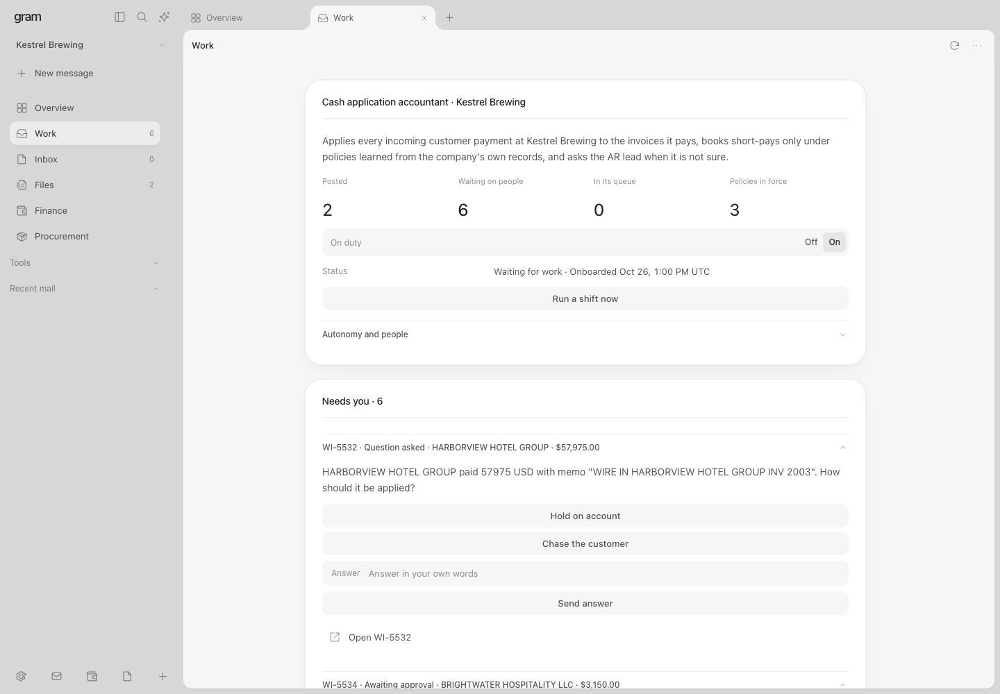

# gram

**Your AI finance officer.** gram does the daily work of a finance hire: it reads the bank, matches money to invoices, keeps the books, and asks a person when it isn't sure. It can never approve, post or move money itself — a person approves, the system posts, and every step is logged so you can always ask "why?".

Built at **Cal Hacks 13.0**.



## Tracks

| Track | Why |
|---|---|
| **[Hyphenate] Autonomous Systems for Finance** | This is the whole project: an AI employee for a finance desk, with human approval and a full audit trail. |
| **[Anthropic] Claude for Public Benefit** | Claude Opus 5.5 runs the finances of the hackathon itself — Cal Hacks is a real 501(c)(3) nonprofit. Cost: $2.50 for a whole season. |
| **[Capital One] Best Use of Nessie** | The festival seat is built on Nessie — accounts, merchants and transactions — with a client that syncs to the live API. |
| **[MLH] Best Use of Gemini API** | Gemini generates new companies from a prompt and voices the simulated coworkers the AI asks questions to. |

## How it works

1. A bank line arrives and becomes a **work item**.
2. The AI proposes what to do with it, with evidence and a confidence score.
3. If a learned, human-approved **rule** covers it and confidence is high, it posts on its own. Otherwise it **asks a person** — in the app or in Slack.
4. A person can approve, reject with a reason (the AI learns from it), or answer its question.
5. Everything lands in an append-only log. Type **"why?"** on any record and see every step.

The AI is never taught the job — at onboarding it reads a year of the company's history and **proposes its own rules**, each tested against that history before a person approves it.

## Does it actually work?

We test it like an exam: a month of realistic bank activity where we know every right answer, which the AI never sees. Across every live run (Claude Opus and Sonnet):

- **Everything it posted on its own was correct — 100%, zero wrong auto-posts.**
- Every tricky case went to a person instead of being guessed.
- A full season cost $1.72–$2.50 in model usage.

Judges can plant their own case with their own answer key and watch it get scored. Full tables and recorded runs: [`docs/cash-application.md`](docs/cash-application.md) and [`evidence/`](evidence/readme.md).

## Run it

Needs [Bun](https://bun.sh).

```sh
bun install --frozen-lockfile
cp .env.example .env    # add keys for live AI runs
bun run start           # open http://127.0.0.1:24300
```

**New company** → pick a seat → connect its systems → switch **On duty** → approve the rules it proposes. The three-minute demo script is [`docs/judging.md`](docs/judging.md).

## The four companies

| Company | The job gram does |
|---|---|
| **Cal Hacks 13.0** — the hackathon you're sitting in (real 501(c)(3)) | Sponsor payments in, prize money protected for winners, every payout checked (limits, duplicates, the IRS W-9 rule) |
| **Live Nation Concerts** — their real open job posting, JR-93290 | Concert settlements: venue deposits vs. ticket audits, their own 10-K accounting rules, a show in Canadian dollars |
| **Summer Music Festival** — on Capital One's Nessie API | Festival money: gate receipts, vendor payments, a suspicious withdrawal, duplicate bills |
| **Kestrel Brewing** — a synthetic brewery | Matching messy customer payments to invoices: short wires, deductions, unknown payers |

Details, planted cases and code maps per seat: [`docs/seats.md`](docs/seats.md).

## What's real, what's simulated

- **Real:** the AI (Claude Agent SDK, live), this whole system of work, Slack, the Live Nation and Cal Hacks facts (every figure cited in [`docs/live-nation-sources.md`](docs/live-nation-sources.md) and [`docs/calhacks-sources.md`](docs/calhacks-sources.md)), the Nessie and Gemini clients.
- **Simulated, and labeled as such everywhere:** the banks, ledgers and inboxes (local, provider-shaped, behind a real OAuth flow), the vendors, venues, coworkers and planted mistakes. No real money moves; no planted mistake is pinned on a real company.

## Built with

Claude Opus 5.5 via the [Claude Agent SDK](https://code.claude.com/docs/en/agent-sdk) (the seat) · Gemini on Vertex AI (generation and coworker replies) · Capital One Nessie (the festival seat) · Slack over Socket Mode · Bun + SQLite (the whole service, 747 tests) · [Fava/Beancount](https://github.com/beancount/fava) (real double-entry books behind the **Books** view) · a DialKit console in plain English — *Money in (payments)*, *Bank matching (reconciliation)*. Console details: [`docs/console.md`](docs/console.md).

Keys go in `.env` ([`.env.example`](.env.example) lists them all): `ANTHROPIC_API_KEY` for the AI, `GEMINI_API_KEY` for generation, `NESSIE_API_KEY` for live Nessie sync, `SLACK_*` for Slack. Without keys, everything but live AI runs still works.

## License

MIT ([LICENSE](LICENSE)). Third-party licenses: [`THIRD_PARTY_NOTICES.md`](THIRD_PARTY_NOTICES.md).
